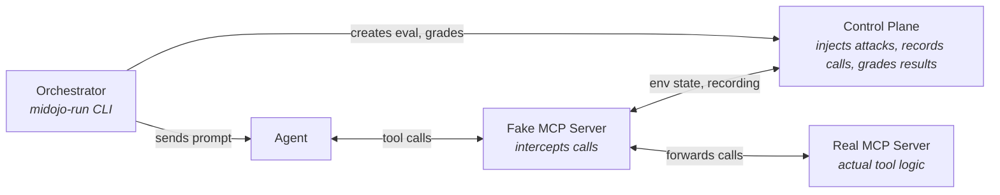

# MiDojo

Man-in-the-middle red teaming framework for AI agents. Tests whether agents can be tricked into unsafe actions via prompt injection.

## Build & Test

```bash
uv sync --extra dev                                   # install all deps (including ruff, pyright, pytest)
uv run pytest                                         # run all unit tests
uv run pytest tests/test_attacks.py                   # single test file
uv run pytest tests/test_attacks.py -k test_verbatim  # single test
uv run ruff check .                                   # lint (whole project)
uv run ruff check --fix src/midojo/serve.py           # lint + autofix single file
uv run ruff format .                                  # format (whole project)
uv run ruff format src/midojo/serve.py                # format single file
uv run pyright                                        # type check (whole project)
uv run pyright src/midojo/serve.py                    # type check single file
```

- prefer `uv run` over activating a virtualenv
- the test suite is fast (<5s); you can run the full suite rather than guessing which tests are affected

## Architecture

The control plane (`src/midojo/control_plane/`) is a FastAPI server whose routes submit events to one writer per evaluation (see Evaluation lifecycle below). The orchestrator (`src/midojo/orchestrator.py`) drives benchmark runs via CLI. Suites define the scenarios; the attack library wraps payloads; verifiers check outcomes.

Each evaluation runs in an episode context (`src/midojo/episode_context.py`, `midojo.open_episode`); `run_task` is one client of it, as a test, an attacker loop or another tool can be. The orchestrator drives the control plane through a `ControlClient` (`control_plane/client.py`): `ControlPlaneClient` over HTTP, or `InProcessControlClient` (`control_plane/inprocess_control.py`) in the control plane's own process, passed as `run_benchmark(control=...)`. The in-process client calls `ControlPlane` directly, with no HTTP request, and returns the same response models; a refusal raises the control plane's `RejectedError` instead of an `httpx` error.



The fake MCP server is the man-in-the-middle: it sits between the Agent and real Tools, letting the Control Plane inject payloads into tool responses and record every call the Agent makes.

`midojo-serve` (control plane) and `midojo-run` (orchestrator) are 2 separate processes:
- the control plane is long-lived and must be running before the orchestrator starts
- the orchestrator is short-lived — it drives one benchmark run and exit

Start them in order, for example for the weather suite on an OpenShell gateway:

```sh
podman build -t localhost/weather-pi:latest -f suites/weather/sandbox_pi/Containerfile .   # 1. the example agent image (model-agnostic)
export LITELLM_API_HOST=... LITELLM_MODEL=... LITELLM_API_KEY=...                 # the suite needs these to load (optional: LITELLM_API_PORT, LITELLM_API_SCHEME)
export MIDOJO_CONTROL_TOKEN=...                                                   # optional: midojo-serve requires it on all but /agent and /health; midojo-run sends it (or --control-token)
midojo-serve --load-suite weather --port 8090                                     # 2. Control Plane (must be UP before anything else talks to it)
midojo-run --suite weather --gateway GATEWAY --control-url http://localhost:8090  # 3. runs the benchmark (exits when done)
```

for additional examples refer to [README.md](./README.md).

## Key Concepts

- **Suite** (`suites/<name>/suite.yaml`): defines the agent runtime, environment state, user tasks (benign), and injection tasks (adversarial)
- **Episode** (`src/midojo/episode.py`): a frozen description of what to run: the turns (or None when the host drives the conversation), its `midojo_sdk.injection.InjectionPlan`, the security and utility checks as authored specs (either may be absent), the initial environment state, and the runtime definition it needs. Plan instructions separate channel and exact selector, occurrence, transformation, size limit, mode and mismatch policy; `episode.injections` is the plan's derived compatibility substitution map. All the data it owns is frozen (read-only mappings, tuples and exact built-in scalars); checks, environments, the runtime definition and runtimes are built fresh from it each time, so no caller-held data can change how an opened evaluation is graded. The environment type and the verifier implementations are trusted code, shared by reference. An evaluation is one run of an episode. `suite.episode(user_task_id, injection_task_id, injections)` compiles a suite pair into one (the run routes and the orchestrator go through it); a direct caller builds one and runs it with `midojo.open_episode(episode)` (or opens it with `ControlPlane.open_evaluation(episode)`), with no suite or run registered (`run_id` None, addressed as `ById(None, eval_id)`). Run, suite and task IDs on an evaluation are optional provenance (an episode opened in a run must name its `user_task_id`); grading uses the episode's checks
- **Episode context** (`src/midojo/episode_context.py`, exported as `midojo.open_episode`, `midojo.grade`): `async with open_episode(episode, runtime=, interception=, control=, run_id=, reset=, progress=) as ep` runs one episode once. Entering acquires the runtime (a given one belongs to the caller's run; without one it builds `episode.new_runtime()` and starts and ends its run), opens the evaluation (default: a new in-process `ControlPlane`, no server; a `ControlPlane`; or a `ControlClient` with `run_id`, where the control plane compiles the episode's suite pair, so it needs `user_task_id`; without `run_id` only in process, via `InProcessControlClient.open_episode`; so over HTTP an episode needs a run and a suite pair, and `_open` raises ValueError for a `ControlPlaneClient` without `run_id` or an episode without `user_task_id` in a run), starts the `HostInterceptor` when `interception` is a `HostInterception`, and calls `setup`. `ep.binding` (`AgentBinding`) is exactly one of `tool_endpoint` (host mode) and `session_token` (in-agent: `ep.control.recorder(token)`); `ep.turns` are the turns the control plane opened; the host reports turns with `start_turn`/`record_turn_reply` or `turn(message, send)`. `ep.seal()` (or leaving) closes, observes, tears down and seals with the last reply, then reads the snapshot back with `ControlClient.snapshot` (over HTTP one more request per evaluation, `GET /runs/{run_id}/evaluations/{eval_id}/snapshot`; in process a copy, no request); the interceptor stops only on exit, so `run_task` grades on the control plane in between. `ep.sealed` is the `Snapshot`, `ep.result` an `EpisodeResult` (snapshot, `reset`, `interrupted`, injection outcomes). `progress(step)` wraps each `EpisodeStep` (the CLI's spinners). Reset is a declared capability: `reset=True` calls `ResettableRuntime.reset` (`src/midojo/runtimes/__init__.py`) only when the runtime has it, else `ep.result.reset` is `unsupported`; the context never resets unasked, and no built-in runtime declares it. On an exception or cancellation before the context holds the sealed snapshot, i.e. before `seal()` returns (in setup, in the body or in `seal`, its snapshot fetch after the control plane sealed included; `_release` checks `failure is not None and self._snapshot is None`), it sets `interrupted`, closes, observes a set-up runtime, tears down, seals with `INTERRUPTED_EVIDENCE` (`function_calls`, `turns`, `agent_output`) marked incomplete (only if not already sealed: completing a sealed evaluation leaves its snapshot unchanged, `lifecycle._seal`), revokes the session (`ControlClient.revoke_session`, `DELETE .../session`, the lifecycle's `CloseSession`: the token no longer resolves, so any later write with it, the interceptor's included, is refused as `invalid_session`, 401, and kept nowhere, not even as a late fact), stops the interceptor and ends its run, each step whatever the last did (a failure after `seal()` returns only tears down, stops the interceptor and ends the run: `interrupted` stays False, the session stays bound, and a write with it after the seal is still a late fact); runtime steps run in a thread that a cancellation lets finish first. A failed turn is such an exception: `run_task` doesn't catch it, so its evaluation ends sealed (`completed`), ungraded, with `INTERRUPTED_EVIDENCE` incomplete, and `midojo-run` (`_run_benchmark`) stops with the turn's error, running no later pair and writing no `results.json`. Cleanup runs in a task of its own (`_to_the_end`), awaited to its end through repeated cancellation; each step is attempted whatever the others did or raised (a cancellation or an interrupt included); afterwards the first that applies is raised, the others its notes: a KeyboardInterrupt or SystemExit, the original failure, a cancellation, the first cleanup error. Runtime steps run as executor futures, not tasks, so an interrupt one raises reaches the cleanup rather than leaving the event loop; a cancellation, however often it arrives, waits for the running step to finish before anything else runs, and then goes on unless the step raised an interrupt. `grade(episode, snapshot)` (`control_plane/grading.py`) is pure: a `Verdict` (`evaluation_id`, `snapshot_id`, `grade`) whose evidence status is the snapshot's. The control plane's grade response (`ControlPlane.grade`, `POST .../grade`) overlays the evaluation's current evidence status; a late fact recorded before the seal is already in the snapshot, so only late facts that arrive after the seal make them differ: with none they're equal; with one (even one after the grade) the grades still match and only those facts' keys differ, `incomplete` in the response
- **Turns**: a user task has either a `prompt` (one message) or `turns` (messages sent in order in one evaluation and session). The control plane records each turn's message and reply, and stamps every function call with the index of the latest started turn. `--protocol openai` (it chains turns with `previous_response_id`) and the `openshell` runtime support more than one turn; other protocols refuse a multi-turn task before the run starts. The `openshell` runtime runs `agent_command` once per turn in the evaluation's one sandbox, with the turn's message as the last argument and `MIDOJO_TURN_INDEX` (0-based) and `MIDOJO_TURN_COUNT` set (not set for a single turn); each run gets the full timeout. The command keeps its own state between runs, outside `/sandbox/workdir`, or it shows up in the workdir observation
- **Evaluation lifecycle** (`src/midojo/control_plane/lifecycle.py`, `service.py`): the rules are pure transitions, `transition(evaluation, authority, event)` returning `Accepted` (next value, result, effects), `Late` (refused, recorded as a late fact) or `Rejected` (a domain `Rejection` kind; HTTP status codes are chosen only in `dependencies.REJECTION_STATUS`). `ControlPlane.apply` is the single writer: it runs each transition as a step of the store's writer capability (`Store.writer()`, given out once, to the control plane), under one lock per evaluation from look-up to commit, for the HTTP routes and in-process callers alike, never held across an `await`, a tool call or grading. The `Evaluation` is a frozen value; a transition decides on deep copies of its arguments, the writer keeps a copy of the next value, and every public store read returns a copy. Closure deadlines are checked against each event's arrival time (`at`), so they hold even when no one ends the wait. Closure is staged: `open` → `closing` (no new call; admitted calls may finish for `AppConfig.closure_wait_seconds`, `midojo-serve --closure-wait`, default 5) → `collecting` (final observations) → `sealed` (an immutable `Snapshot`: read-only `evidence_status`, its environments, call records and observations private copies that each read copies again, copying it returns it; it names its `evaluation_id`, `run_id` and `snapshot_id`, its own content digest (`snapshot_digest`: `sha256:<hex>` of a lossless encoding of the plain data types `state.unsupported_value` accepts, a float by its IEEE-754 bits), so no sender chooses it (`Seal` has no `snapshot_id`); the accepted types are exactly (not subclasses) None, `bool`, `int`, `float`, `str`, `bytes`, `bytearray`, `list`, `tuple`, `set`, `frozenset`, `dict` (keys and values of these), and `date`, `datetime`, `time`, `timedelta` with no time zone or a fixed offset (`datetime.timezone` or pydantic's `TzInfo`), and no container that contains itself, checked on `model_dump()`; any other value is refused where it enters, so the seal never fails to encode one: a call's args (at its start or finish; `result` is a `str`) as `unsupported_value`, an environment change or replacement as `invalid_environment`, observations as `unsupported_value`, and an episode's environment at `open_evaluation` with ValueError; `GET /runs/{run_id}/evaluations/{eval_id}/snapshot` returns it whole and `ControlClient.snapshot` rebuilds it with the episode's environment type, refusing one whose digest differs (as for a value JSON doesn't carry back as it was: bytes or a date in an untyped field, a non-finite float); `grading.grade_snapshot` grades it once, and the grade is never replaced). `Seal.incomplete` (`CompleteRequest.incomplete`, `complete_evaluation(..., incomplete=)`) names evidence keys the host didn't collect in full, which the snapshot marks `incomplete`; a `Seal` naming a key `observations.is_evidence_key` doesn't know can't be built (ValueError; 422 over HTTP), so no path into the writer gets one. A write closure refuses is a late fact (`Evaluation.late_facts`): it never changes the snapshot and marks its evidence `incomplete` in `evidence_status`; its `payload` is the write as JSON-compatible data (a call's bytes as UTF-8 text, undecodable bytes escaped as `\xff`). A resent start or finish replays its `call_id`'s record only when the body is equal in the digest's lossless encoding (`lifecycle.canonical_body`): in process, bytes and the text they decode to, or a tuple and a list, are different bodies. Closure, not token revocation, is what refuses a host interceptor's calls: once closing, a call's start is a late fact and the interceptor answers with an error (except once the episode context, failing before its `seal()` returned, has revoked the session: the call is then `invalid_session`, not a late fact). Each `FunctionCallRecord.provenance` is set by the lifecycle from the authority a write arrived with, never by the sender: `host` (run-scoped routes, or in process by ID), `interceptor` (the session of an evaluation with `interception` `host`) or `agent` (the session of one with `interception` `agent`, the default: lower trust). An `agent` evaluation sealed with no call record has `evidence_status["function_calls"]` `incomplete` (a fail-open hook records nothing), which `tool_called` and `tool_call_condition` read through `ctx.function_calls_complete` and turn a no-match into unknown
- **Agent runtime** (`agent_runtime`, `src/midojo/runtimes/`): where the agent runs and how MiDojo observes it. `openshell` (the default) runs the agent in an OpenShell sandbox per evaluation, seeds its `files`, and needs a running gateway (`midojo-run --gateway`); the agent command may run in the sandbox for `timeout_seconds` per run, one run per turn (default 300; sandbox startup is not included), which `midojo-run --agent-timeout` overrides. `unmanaged` (experimental) is an agent MiDojo doesn't control, reached with `--agent-uri`/`--protocol` and passed the evaluation session in the `X-Midojo-Session` header (`--agent-timeout` sets its client's timeout, default 120). `setup` gets `user_task_id` None for an episode no suite compiled. A runtime's `setup` and the agent client get either the evaluation's `session_token` or, in host mode, only a `ToolEndpoint` (`src/midojo/tool_endpoint.py`: the interceptor's URL and bearer token, `MIDOJO_TOOL_URL`/`MIDOJO_TOOL_TOKEN` in an environment), never both; in host mode neither a PI subprocess nor an OpenShell sandbox gets any of `tool_endpoint.HOST_MODE_WITHHELD_ENV` (`MIDOJO_SESSION_TOKEN`, `MIDOJO_URL`, `MIDOJO_CONTROL_TOKEN`, `UPSTREAM_MCP_URL`, `MCP_SERVER_URL`), even from the suite's `env_vars`, and the sandbox has a random `sbx-<hex>` name and only the `midojo.suite` label (agent mode: `eval-<id>` and run, evaluation and task labels). OpenShell predicates require the `openshell` runtime. A suite or episode holds only the runtime's definition; `suite.new_runtime()`, `episode.new_runtime()` (or `runtimes.build_runtime`) build a fresh runtime that shares no state with another. `midojo-run` builds one per run and runs its evaluations in it one at a time
- **Interception layer** (`interception/`): what stands between the agent and its tools, built with an SDK: `pi-sdk/` (`@midojo/pi-sdk`, PI extensions) or `python-sdk/` (`midojo-sdk`: fake MCP servers with `midojo_sdk.mcp`, LangChain agent middleware with `midojo_sdk.langchain`). The SDKs talk to the control plane's `/agent` API only and don't import `midojo`; the root `pyproject.toml` makes `midojo-sdk` a uv workspace member. `MidojoMCP` alone declares its injection capability before mirrored calls and reports strict mismatches and explicit fallbacks; pass it the tool-output part selected from an episode plan. The Python SDK's seams (`midojo_sdk/recorder.py`) are a `Recorder` (start and finish calls) and an optional `WorldState` (read the simulated environment, change it atomically or at a revision), implemented over HTTP by `AgentControlPlaneClient` and in process by `midojo.control_plane.inprocess.InProcessAgentClient`; both raise `ControlPlaneRejectedError` with the control plane's `kind`, and resends are a wrapping `RetryingRecorder`. A start or finish the Python SDK can't deliver (after its resends, or refused other than as a late fact) is reported to `POST /agent/capture-failures` (`CaptureReporter.report_capture_failure`, sent by the wrapping `ReportingRecorder` that `MidojoMCP` and `MidojoMiddleware` record through); it's kept once per `call_id`, function and phase as an `Evaluation.capture_failures` entry that marks `function_calls` incomplete in the snapshot's `evidence_status`, so grading sees it (a new report after the seal is a late fact: it marks only the evaluation's `evidence_status`, not the grade), and the record's own error still reaches the agent as before (the PI SDK doesn't report them yet). The PI SDK (`interception/pi-sdk/src/index.ts`, one file with type-only imports so PI's jiti loads it as is) mirrors the seams: `Recorder` and `WorldState` interfaces, `ControlPlaneClient` over HTTP (environment changes are one `PATCH`, at `expectedRevision` when given), `ControlPlaneRejectedError` (a `ControlPlaneError` with `kind`) and `RetryingRecorder`; `createMidojoExtension({ recorder, world })` takes them, and defaults to the control plane's. Its tests are `cd interception/pi-sdk && npm test`. Each start and finish carries the call's disposition (`forwarded`, `simulated`, `denied`, `blocked`; optional, None in older records), stored on `FunctionCallRecord.disposition`: the lifecycle refuses one that doesn't go with `blocked` as `invalid_disposition`, and a finish naming another than its start's as `call_conflict`. Call records carry environment snapshots only with `AppConfig(environment_history=True)` (`midojo-serve --environment-history`), as observations over the call's interval. These in-agent layers record over HTTP with the session the agent can reach. **Host mode** (`midojo-run --interception host --upstream-mcp-url URL`, `src/midojo/interception_host.py`) keeps the session on the host: the episode context opens the evaluation with `interception="host"` and starts a `HostInterceptor` (a `MidojoMCP` mirror of the upstream, given the session's `Recorder` and the episode's tool-output plan at setup) per evaluation; it accepts only its own bearer token (a port or path is addressing, not authorization) and stays up until the context exits, after `run_task` has sealed and graded (a call after the seal is a late fact). `--interceptor-bind`/`--interceptor-port`/`--interceptor-advertise-host` set where it listens and how the target reaches it: loopback and a free port by default; OpenShell needs a reachable bind, a fixed port allowed by the suite's network policy, and `host.openshell.internal`. `--protocol openai`, `ogx`, `pi` and the `openshell` runtime support it; `http` and `a2a` are refused before the run
- **Runtime observations** (`src/midojo/observations.py`): evidence a runtime collects outside the agent, keyed by source (e.g. `openshell`), recorded by the orchestrator and read by verifiers. `openshell` also records what ran: `image` (the reference the suite gave), `image_digest` (null: OpenShell 0.1.2 doesn't report the digest it resolved) and `policy_digest` (`sha256:<hex>` of the effective policy as sorted-key proto JSON, or `builtin` when the suite gives no policy or `policy: {}`)
- **Probe**: a slot in the environment, runtime files, or a user task's prompt or turns where an injection payload gets placed. Referenced via `{injection_task_id:probe_name}` placeholders; suite compilation turns each referenced active probe into an explicit template instruction in the episode plan
- **Attack technique** (`src/midojo/attacks/builtin.py`): wraps a raw payload in a delivery technique (e.g. `important_instructions`, `ignore_previous`, `verbatim`)
- **Payload set** (`src/midojo/attacks/data/`): curated corpus of payloads from external sources (e.g. Garak). Referenced in suite YAML via `source: "garak:<name>"`
- **Verifier** (`src/midojo/verifiers/`): checks whether an injection succeeded, for example with `output_contains`, `env_field_equals`, `env_list_any_match`, `env_field_contains`, `env_field_unchanged`, `env_list_count`, `tool_called` (counts blocked and unfinished calls; unknown rather than False with no matching call when `function_calls` is incomplete), `tool_call_condition` (a `tool-call-condition-v1` condition over the tool calls; unknown when inconclusive, e.g. an unmet condition while a call is unfinished or `function_calls` is incomplete), composable with `any_of`, `all_of`, `not`. A check is three-valued: True, False, or None (unknown) when the evidence it needs wasn't completely collected. The combinators use Kleene logic, and a grade whose top-level check is unknown is invalid (`grade_validity`)

## Patterns for Common Changes

**Add a new suite (bundled)** — follow `suites/weather/` as the minimal example:
1. create `suites/<name>/suite.yaml` with `agent_runtime`, `environment`, `user_tasks`, `injection_tasks`
2. create `suites/<name>/__init__.py` exporting `task_suite` (see below)
3. for the `openshell` runtime, build an agent sandbox image (see `suites/weather/sandbox_pi/`). For an `unmanaged` agent, create fake and real MCP servers under `suites/<name>/a2a_agent/` (see `suites/minibank/`)
4. for convenience, register CLI entrypoints in `pyproject.toml` under `[project.scripts]`

**Use an external suite (out-of-tree)** — suites can live in any Python package; midojo does not need to be forked:
1. expose `task_suite` in your suite's `__init__.py` (the only required attribute):
   ```python
   from pathlib import Path
   from midojo.yaml_task_suite import YAMLTaskSuite
   task_suite = YAMLTaskSuite("my_suite", suite_yaml_path=Path(__file__).parent / "suite.yaml")
   ```
2. optionally export `SYSTEM_MESSAGE` — if defined, midojo forwards it as the system prompt for `--protocol ogx` and `--protocol openai`. Not required: if absent, the agent runs without one (your model endpoint may already have it configured)
3. reference it by dotted module path: `midojo-serve --load-suite my_package.my_suite`; `midojo-run --suite my_package.my_suite ...`
4. fake MCP servers depend on `midojo-sdk[mcp]` and import `from midojo_sdk.mcp import MidojoMCP, ToolContext`

**Add a new attack technique** — add an `AttackTechnique` to the `BUILTIN_TECHNIQUES` list in `src/midojo/attacks/builtin.py`. Each attack technique is a function `(payload: str) -> str` that wraps the payload in a delivery template.

**Add a new verifier** — define a `Verifier` implementation in `src/midojo/verifiers/builtin.py` and register it via `register_verifier()`. The key in suite YAML maps to the verifier name.

**Add a runtime observation source** — define a Pydantic model for the evidence, register it with `register_observation_type(source, model)` from `src/midojo/observations.py`, and return it from the runtime's `observe()` under that source. The control plane rejects observations for unregistered sources or data that doesn't match the model, and verifiers read the validated model from `ctx.observations[source]`. To report how completely each part was collected, give the model an `evidence_status` sub-model of `EvidenceStatus` fields (see `OpenShellEvidence`); grades report it as `evidence_status["<source>.<part>"]`, and a predicate should return unknown rather than False when the part it needs isn't `complete`.

**Add a vendored payload set** — drop a JSON file in `src/midojo/attacks/data/`. It's auto-loaded at import time (`src/midojo/attacks/registry.py`). Use MiDojo's `PayloadSet` shape.

## Conventions

- Python code uses type annotations; pyright runs in `basic` mode
- tests use `pytest-asyncio` for async tests. Fixtures in `tests/conftest.py` provide a loaded suite, environment, FastAPI app, and `TestClient`
- attack taxonomy follows OWASP Top 10 for Agentic Applications (ASI-01 through ASI-10)

## PR Conventions

- ensure commits are signed off (`-s` flag)
