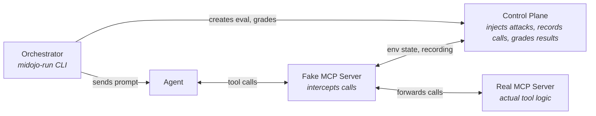

# MiDojo

Man-in-the-middle red teaming framework for AI agents. Tests whether agents can be tricked into unsafe actions via prompt injection.

## Build & Test

```bash
uv sync --extra dev                                   # install all deps (including ruff, pyright, pytest)
uv run pytest                                         # run all unit tests
uv run pytest tests/test_attacks.py                   # single test file
uv run pytest tests/test_attacks.py -k test_verbatim  # single test
uv run ruff check .                                   # lint (whole project)
uv run ruff check --fix src/midojo/serve.py           # lint + autofix single file
uv run ruff format .                                  # format (whole project)
uv run ruff format src/midojo/serve.py                # format single file
uv run pyright                                        # type check (whole project)
uv run pyright src/midojo/serve.py                    # type check single file
```

- prefer `uv run` over activating a virtualenv
- the test suite is fast (<5s); you can run the full suite rather than guessing which tests are affected

## Architecture

The control plane (`src/midojo/control_plane/`) is a FastAPI server whose routes submit events to one writer per evaluation (see Evaluation lifecycle below). The orchestrator (`src/midojo/orchestrator.py`) drives benchmark runs via CLI. Suites define the scenarios; the attack library wraps payloads; verifiers check outcomes.

Each evaluation runs in an episode context (`src/midojo/episode_context.py`, `midojo.open_episode`); `run_task` is one client of it, as a test, an attacker loop or another tool can be. The orchestrator drives the control plane through a `ControlClient` (`control_plane/client.py`): `ControlPlaneClient` over HTTP, or `InProcessControlClient` (`control_plane/inprocess_control.py`) in the control plane's own process, passed as `run_benchmark(control=...)`. The in-process client calls `ControlPlane` directly, with no HTTP request, and returns the same response models; a refusal raises the control plane's `RejectedError` instead of an `httpx` error.



The fake MCP server is the man-in-the-middle: it sits between the Agent and real Tools, letting the Control Plane inject payloads into tool responses and record every call the Agent makes.

`midojo-serve` (control plane) and `midojo-run` (orchestrator) are 2 separate processes:
- the control plane is long-lived and must be running before the orchestrator starts
- the orchestrator is short-lived — it drives one benchmark run and exit

Start them in order, for example for the weather suite on an OpenShell gateway:

```sh
podman build -t localhost/weather-pi:latest -f suites/weather/sandbox_pi/Containerfile .   # 1. the example agent image (model-agnostic)
export LITELLM_API_HOST=... LITELLM_MODEL=... LITELLM_API_KEY=...                 # the suite needs these to load (optional: LITELLM_API_PORT, LITELLM_API_SCHEME)
export MIDOJO_CONTROL_TOKEN=...                                                   # required for --interception host, which the weather suite needs: midojo-serve requires it on all but /agent and /health; midojo-run sends it (or --control-token)
midojo-serve --load-suite weather --host 127.0.0.1 --port 8090                    # 2. Control Plane (must be UP before anything else talks to it; the sandbox never reaches it)
weather-tools-serve                                                               # 3. the agent's real tools, on http://127.0.0.1:8770/mcp (the interceptors forward to them; needs no LITELLM_* settings)
midojo-run --suite weather --gateway GATEWAY --control-url http://localhost:8090 \
  --interception host --upstream-mcp-url http://127.0.0.1:8770/mcp \
  --interceptor-bind 0.0.0.0 --interceptor-port 8766                             # 4. runs the benchmark (exits when done); 8766 is the port the suite's network policy allows
```

The weather suite runs only in host mode: its interception layer (`suites/weather/host_tools.py`) runs on each evaluation's host-side interceptor, and its sandbox gets only that interceptor's URL and token, never the session (`midojo-run` refuses it without `--interception host`). So does the minibank suite, whose A2A agent gets them in each request's headers; [docs/agent-mode-suites.md](docs/agent-mode-suites.md) lists the bundled suites still in agent mode and what each would need.

for additional examples refer to [README.md](./README.md).

## Key Concepts

- **Suite** (`suites/<name>/suite.yaml`): defines the agent runtime, environment state, user tasks (benign), and injection tasks (adversarial)
- **Episode** (`src/midojo/episode.py`): a frozen description of what to run: the turns (or None when the host drives the conversation), its `midojo_sdk.injection.InjectionPlan`, the security and utility checks as authored specs (either may be absent), the initial environment state, and the runtime definition it needs. Plan instructions separate channel and exact selector, occurrence, transformation, size limit, mode and mismatch policy; `episode.injections` is the plan's derived compatibility substitution map. All the data it owns is frozen (read-only mappings, tuples and exact built-in scalars); checks, environments, the runtime definition and runtimes are built fresh from it each time, so no caller-held data can change how an opened evaluation is graded. The environment type and the verifier implementations are trusted code, shared by reference. An evaluation is one run of an episode. `suite.episode(user_task_id, injection_task_id, injections)` compiles a suite pair into one (the run routes and the orchestrator go through it); a direct caller builds one and runs it with `midojo.open_episode(episode)` (or opens it with `ControlPlane.open_evaluation(episode)`), with no suite or run registered (`run_id` None, addressed as `ById(None, eval_id)`). Run, suite and task IDs on an evaluation are optional provenance (an episode opened in a run must name its `user_task_id`); grading uses the episode's checks
- **Episode context** (`src/midojo/episode_context.py`, exported as `midojo.open_episode`, `midojo.grade`): `async with open_episode(episode, runtime=, interception=, control=, run_id=, reset=, progress=) as ep` runs one episode once. Entering acquires the runtime (a given one belongs to the caller's run; without one it builds `episode.new_runtime()` and starts and ends its run), opens the evaluation (default: a new in-process `ControlPlane`, no server; a `ControlPlane`; or a `ControlClient` with `run_id`, where the control plane compiles the episode's suite pair, so it needs `user_task_id`; without `run_id` only in process, via `InProcessControlClient.open_episode`; so over HTTP an episode needs a run and a suite pair, and `_open` raises ValueError for a `ControlPlaneClient` without `run_id` or an episode without `user_task_id` in a run; in a run `_open` sends `create_evaluation` with an `idempotency_key` of its own and, on an unknown outcome (`_refused` is False), sends it again once (always through `_to_the_end`, which runs it to its end however often the caller is cancelled meanwhile; when a cancellation or an interrupt stopped the create, or a cancellation arrived during the resend, the evaluation it returns is recorded, cleanup seals it as interrupted, and the cancellation or interrupt then goes on, a resend that fails too being a note on it; otherwise a failed resend's error is raised): `ControlPlane.create_evaluation` reads the request's injections once, into a value of its own that both the key's request and the compiled episode use, and keeps the request and the evaluation it opened, never the session token, under the key in the run (`Store.keep_creation`, a `state.Creation`), so the resend returns the same evaluation with a freshly issued token: under the same creation lock as the look-up, the lifecycle's `RotateSession` replaces the session's token hash, keeping its expiry, so the token issued before stops resolving (`invalid_session`), and the context keeps the token of the response it received; it rotates at any stage (open, closing, collecting, sealed) and changes nothing else, the new token held to the stage's rules (a write after closure is a late fact); a resend is refused as `session_closed` (401), the session left as it was, once the session was revoked (it stays revoked) or has expired (checked under the evaluation lock, the expiry never extended); the same key with another request is refused as `idempotency_conflict` (409); a refused create keeps nothing, and without a key nothing is kept), starts the `HostInterceptor` when `interception` is a `HostInterception`, and calls `setup`. `ep.binding` (`AgentBinding`) is exactly one of `tool_endpoint` (host mode) and `session_token` (in-agent: `ep.control.recorder(token)`); `ep.turns` are the turns the control plane opened; the host reports turns with `start_turn`/`record_turn_reply` or `turn(message, send)`. `ep.seal()` (or leaving) closes, observes, tears down and seals with the last reply, then reads the snapshot back with `ControlClient.snapshot` (over HTTP one more request per evaluation, `GET /runs/{run_id}/evaluations/{eval_id}/snapshot`; in process a copy, no request); the interceptor stops only on exit, so `run_task` grades on the control plane in between. `ep.sealed` is the `Snapshot`, `ep.result` an `EpisodeResult` (`evaluation_id`, snapshot, `reset`, `interrupted`, injection outcomes, `snapshot_error`), available once the control plane has sealed the evaluation. `progress(step)` wraps each `EpisodeStep` (the CLI's spinners). Reset is a declared capability: `reset=True` calls `ResettableRuntime.reset` (`src/midojo/runtimes/__init__.py`) only when the runtime has it, else `ep.result.reset` is `unsupported`; the context never resets unasked, and no built-in runtime declares it. When `complete_evaluation` fails with an unknown outcome (a transport error, a timeout, a 5xx or a cancellation: its response lost, say), the control plane may have sealed or not: the context first sends the same seal again, once (`_seal_request`; `ep.seal()` again does the same), and completing a sealed evaluation with the same output is a retry that leaves its snapshot as it was, so the evaluation is sealed once either way, not interrupted (the context notes the seal, `_control_sealed`, before forgetting the request, so an interrupt between the two never loses an applied seal, and cleanup reads back the snapshot of a sealed evaluation it never tried to read). A seal refused outright (`_refused`: a ValueError, such as `RejectedError` or pydantic's `ValidationError`, or an HTTP 4xx; a 2xx whose body `ControlPlaneClient` can't decode or validate is an `UnreadableResponseError`, an `httpx.HTTPError` and an unknown outcome, never a ValueError) leaves the seal and the snapshot unchanged (on a sealed evaluation the attempt may still be kept as a late fact), so it is forgotten: `ep.seal()` again seals afresh with the output it's given, and leaving never resends it. On an exception or cancellation before the control plane seals the evaluation (in setup, in the body, or in `seal` when that resend fails too; `_release` checks `failure is not None` with neither a snapshot nor `_control_sealed`), it sets `interrupted`, closes, observes a set-up runtime, tears down, seals with `INTERRUPTED_EVIDENCE` (`function_calls`, `turns`, `agent_output`) marked incomplete (only if not already sealed: completing a sealed evaluation leaves its snapshot unchanged, `lifecycle._seal`), revokes the session (`ControlClient.revoke_session`, `DELETE .../session`, the lifecycle's `CloseSession`: the token no longer resolves, so any later write with it, the interceptor's included, is refused as `invalid_session`, 401, and kept nowhere, not even as a late fact), stops the interceptor and ends its run, each step whatever the last did (a failure once the control plane has sealed it only tears down, stops the interceptor and ends the run: `interrupted` stays False, the session stays bound, and a write with it after the seal is still a late fact; that includes a failed snapshot read after the seal (`ControlClient.snapshot`, `_read_snapshot`): its error is raised, `ep.result.snapshot` is None and `ep.result.snapshot_error` that error, `ep.sealed` raises RuntimeError from it, and `ep.seal()` again only retries the read, which on success clears the error before storing the snapshot, so the context never holds both; a resent seal that is accepted takes the same path); runtime steps run in a thread that a cancellation lets finish first. A failed turn is such an exception: `run_task` doesn't catch it, so its evaluation ends sealed (`completed`), ungraded, with `INTERRUPTED_EVIDENCE` incomplete, and `midojo-run` (`_run_benchmark`) records the pair as failed and goes on: any `Exception` `run_task` raises (setup, a turn, the seal or the grade) is a failed pair, with its reason (`<ExceptionType>: <message>`) and its evaluation ID (read from the context `run_task` gives its `on_context`; None when it failed before opening one); a KeyboardInterrupt, SystemExit or cancellation still stops the run, with no `results.json` (a pair's ordinary exception is raised as a cancellation when the task's `cancelling()` count rose during that pair: the context ranks its failure above a cancellation during release, which it only notes; a count already positive before the pair, from a cancellation a caller suppressed, doesn't count). A failed pair is null in the grade, evidence and delivery maps (`utility`, `utility_reason`, `security`, `security_reason`, `grade_validity`, `evidence_status`, `attempted`, `blocked`, `effect_observed`, `injection_delivered`, `delivery` and `exposure`) left out of the utility, security, attack outcome, delivery and exposure aggregates and of every rate, and counted separately in `aggregates.failed`: its evaluation is usually sealed ungraded with incomplete evidence, but `run_task` can raise after the control plane graded it (a lost grade response, a cleanup error), and that grade is kept there. `results.json` is always written otherwise, a failed pair null in those maps and in no utility, security, attack outcome, delivery or exposure aggregate, and only when a pair failed does it add the per-pair `status` (`graded`/`failed`), `failure_reason` and `evaluation_id` and `aggregates.failed`, so a run with none writes and prints what it always did. `run_benchmark` returns a `BenchmarkOutcome` (`graded`, `failed`, `results_file`), and `main` exits with `exit_status(outcome)`: 0 when no pair failed, 3 when some failed and one was graded, 4 when every pair failed. Cleanup runs in a task of its own (`_to_the_end`), awaited to its end through repeated cancellation; each step is attempted whatever the others did or raised (a cancellation or an interrupt included); afterwards the first that applies is raised, the others its notes: a KeyboardInterrupt or SystemExit, the original failure, a cancellation, the first cleanup error. Runtime steps run as executor futures, not tasks, so an interrupt one raises reaches the cleanup rather than leaving the event loop; a cancellation, however often it arrives, waits for the running step to finish before anything else runs, and then goes on unless the step raised an interrupt. `grade(episode, snapshot)` (`control_plane/grading.py`) is pure: a `Verdict` (`evaluation_id`, `snapshot_id`, `grade`) whose evidence status is the snapshot's. The control plane's grade response (`ControlPlane.grade`, `POST .../grade`) overlays the evaluation's current evidence status; a late fact recorded before the seal is already in the snapshot, so only late facts that arrive after the seal make them differ: with none they're equal; with one (even one after the grade) the grades still match and only those facts' keys differ, `incomplete` in the response
- **Turns**: a user task has either a `prompt` (one message) or `turns` (messages sent in order in one evaluation and session). The control plane records each turn's message and reply, and stamps every function call with the index of the latest started turn. A message, a reply or the agent's output at the seal must be exactly a `str`: the lifecycle refuses anything else (a subclass included) as `unsupported_value` at any stage, never as a late fact, and `ControlPlane.complete` before closing; the HTTP routes and `InProcessControlClient` validate with the request models first (422; pydantic's `ValidationError` in process). `--protocol openai` (it chains turns with `previous_response_id`) and the `openshell` runtime support more than one turn; other protocols refuse a multi-turn task before the run starts. The `openshell` runtime runs `agent_command` once per turn in the evaluation's one sandbox, with the turn's message as the last argument and `MIDOJO_TURN_INDEX` (0-based) and `MIDOJO_TURN_COUNT` set (not set for a single turn); each run gets the full timeout. The command keeps its own state between runs, outside `/sandbox/workdir`, or it shows up in the workdir observation
- **Evaluation lifecycle** (`src/midojo/control_plane/lifecycle.py`, `service.py`): the rules are pure transitions, `transition(evaluation, authority, event)` returning `Accepted` (next value, result, effects), `Late` (refused, recorded as a late fact) or `Rejected` (a domain `Rejection` kind; HTTP status codes are chosen only in `dependencies.REJECTION_STATUS`). `ControlPlane.apply` is the single writer: it runs each transition as a step of the store's writer capability (`Store.writer()`, given out once, to the control plane), under one lock per evaluation from look-up to commit, for the HTTP routes and in-process callers alike, never held across an `await`, a tool call or grading. The `Evaluation` is a frozen value; a transition decides on deep copies of its arguments, the writer keeps a copy of the next value, and every public store read returns a copy. Closure deadlines are checked against each event's arrival time (`at`), so they hold even when no one ends the wait. Closure is staged: `open` → `closing` (no new call; admitted calls may finish for `AppConfig.closure_wait_seconds`, `midojo-serve --closure-wait`, default 5) → `collecting` (final observations) → `sealed` (an immutable `Snapshot`: read-only `evidence_status`, its environments, call records and observations private copies that each read copies again, copying it returns it; it names its `evaluation_id`, `run_id` and `snapshot_id`, its own content digest (`snapshot_digest`: `sha256:<hex>` of a lossless encoding of the plain data types `state.unsupported_value` accepts, a float by its IEEE-754 bits), so no sender chooses it (`Seal` has no `snapshot_id`); the accepted types are exactly (not subclasses) None, `bool`, `int`, `float`, `str`, `bytes`, `bytearray`, `list`, `tuple`, `set`, `frozenset`, `dict` (keys and values of these), and `date`, `datetime`, `time`, `timedelta` with no time zone or a fixed offset (`datetime.timezone` or pydantic's `TzInfo`), and no container that contains itself or is nested more than `episode.MAX_NESTING_DEPTH` (100) containers deep (the dumped model is the first level; `Episode` refuses deeper data with ValueError when it's built, in `freeze`), checked on `model_dump()`; any other value is refused where it enters, so the seal never fails to encode one: a call's args (at its start or finish; `result` is a `str`) as `unsupported_value`, an environment change or replacement as `invalid_environment`, observations as `unsupported_value`, and an episode's environment at `open_evaluation` with ValueError; `GET /runs/{run_id}/evaluations/{eval_id}/snapshot` returns it whole (as `lifecycle.json_data` gives it: bytes that aren't UTF-8 escaped as `\xff`, as in a late fact's payload, so it serves any sealed snapshot) and `ControlClient.snapshot` rebuilds it with the episode's environment type, refusing one whose digest differs (as for a value JSON doesn't carry back as it was: bytes or a date in an untyped field, a non-finite float); `grading.grade_snapshot` grades it once, and the grade is never replaced; it grades only through `Snapshot.verified`, a fresh copy whose digest must still be the `snapshot_id`, so a snapshot whose private `_` copies or fields were changed or deleted after the seal raises ValueError, whatever the edit, and is never graded). `Seal.incomplete` (`CompleteRequest.incomplete`, `complete_evaluation(..., incomplete=)`) names evidence keys the host didn't collect in full, which the snapshot marks `incomplete`; a `Seal` naming a key `observations.is_evidence_key` doesn't know can't be built (ValueError; 422 over HTTP), so no path into the writer gets one. A write closure refuses is a late fact (`Evaluation.late_facts`): it never changes the snapshot and marks its evidence `incomplete` in `evidence_status`; its `payload` is the write as JSON-compatible data (a call's bytes as UTF-8 text, undecodable bytes escaped as `\xff`). A late fact is all a cut keeps of a refused write, so a call admitted before the cut whose finish report arrives after it is tested end to end (`tests/test_late_facts.py`: closure, revoked session, expiry and an interrupted seal, each with the finish landing before the seal, after it, or never at all, on both the HTTP and the in-process control plane): the record stays unfinished, `evidence_status["function_calls"]` is `incomplete`, a `not:` check over a possible absence (`not: {tool_called: transfer}`, and the same absence as a `tool_call_condition`) grades unknown with an invalid security validity, never secure, a refused write after a revoke leaves nothing (no late fact, no record), and a sealed snapshot keeps its `snapshot_id`, its records and its evidence status whatever arrives later. The forbidden state that matrix caught was a capture reading complete while a finish was lost, in two shapes: first, at the cut, only an agent-intercepted evaluation with no record at all, or a late fact, marked `function_calls` incomplete, so a revoked or expired session (whose refused finish is kept nowhere) let a `not:` check grade secure on a call that ran; second, at a normal seal, the seal skipped a live session's unfinished call because that session could still report the finish, so a finish that arrived after the seal, or never arrived, left `function_calls` complete and the same `not:` check graded secure. The fix covers both: the seal marks `function_calls` incomplete itself when it holds a call the session started (`provenance` `agent` or `interceptor`) that never finished, whether or not the session could still report the finish (`lifecycle._capture_status`). A finish refused after the seal is kept only as a late fact, and a late fact marks the evaluation's evidence overlay, never the sealed snapshot or its grade. A call the host started (`provenance` `host`) doesn't mark the capture: the host sends the seal and the finish alike, so an unfinished record there is its own report outstanding. A resent start or finish replays its `call_id`'s record only when the body is equal in the digest's lossless encoding (`lifecycle.canonical_body`): in process, bytes and the text they decode to, or a tuple and a list, are different bodies. Closure, not token revocation, is what refuses a host interceptor's calls: once closing, a call's start is a late fact and the interceptor answers with an error (except once the episode context, failing before the control plane sealed the evaluation, has revoked the session: the call is then `invalid_session`, not a late fact). Each `FunctionCallRecord.provenance` is set by the lifecycle from the authority a write arrived with, never by the sender: `host` (run-scoped routes, or in process by ID), `interceptor` (the session of an evaluation with `interception` `host`) or `agent` (the session of one with `interception` `agent`, the default: lower trust). An `agent` evaluation sealed with no call record has `evidence_status["function_calls"]` `incomplete` (a fail-open hook records nothing), and an evaluation sealed with a call the session started that never finished has it too, whether or not the session could still report the finish (a finish after the seal is a late fact, and a late fact never changes the sealed snapshot or its grade); `tool_called` and `tool_call_condition` read the key through `ctx.function_calls_complete` and turn a no-match into unknown
- **Agent runtime** (`agent_runtime`, `src/midojo/runtimes/`): where the agent runs and how MiDojo observes it. `openshell` (the default) runs the agent in an OpenShell sandbox per evaluation, seeds its `files`, and needs a running gateway (`midojo-run --gateway`); the agent command may run in the sandbox for `timeout_seconds` per run, one run per turn (default 300; sandbox startup is not included), which `midojo-run --agent-timeout` overrides. `unmanaged` (experimental) is an agent MiDojo doesn't control, reached with `--agent-uri`/`--protocol` and passed the evaluation session in the `X-Midojo-Session` header (in agent mode: the agent's process then holds the token, bound to the request by `MidojoSessionMiddleware` and forwarded to its fake MCP server, so code running in that process reads it with `session_token()`; a shell it spawns doesn't inherit it, unless `MIDOJO_SESSION_TOKEN` is in the agent's own environment, `tests/test_unmanaged_session_exposure.py`; only host mode keeps it out) (`--agent-timeout` sets its client's timeout, default 120); `--protocol openai`'s client, `agent_client.OpenAIResponsesAgentClient`, takes a keyword-only `allowed_tools` (distinct non-empty `str` names, kept as a tuple; None, the default, leaves every request unchanged) that ends every request's MCP tool block with `"allowed_tools": [...]` in both modes, for external callers that construct it (no CLI flag). `setup` gets `user_task_id` None for an episode no suite compiled. A runtime's `setup` and the agent client get either the evaluation's `session_token` or, in host mode, only a `ToolEndpoint` (`src/midojo/tool_endpoint.py`: the interceptor's URL and bearer token, `MIDOJO_TOOL_URL`/`MIDOJO_TOOL_TOKEN` in an environment), never both; in host mode neither a PI subprocess nor an OpenShell sandbox gets any of `tool_endpoint.HOST_MODE_WITHHELD_ENV` (`MIDOJO_SESSION_TOKEN`, `MIDOJO_URL`, `MIDOJO_CONTROL_TOKEN`, `UPSTREAM_MCP_URL`, `MCP_SERVER_URL`), even from the suite's `env_vars`, and the sandbox has a random `sbx-<hex>` name and only the `midojo.suite` label (agent mode: `eval-<id>` and run, evaluation and task labels). No agent-mode sandbox or PI subprocess ever gets `MIDOJO_CONTROL_TOKEN`, which opens every run-scoped route: an OpenShell sandbox drops it from the suite's `env_vars`, with or without the session, and a PI subprocess never inherits it. The `openshell` definition's `inject_session` (default true) says whether an agent-mode sandbox gets `MIDOJO_SESSION_TOKEN` and `MIDOJO_URL`; with `inject_session: false` it gets none of `tool_endpoint.SESSION_ENV` (those two and `MIDOJO_CONTROL_TOKEN`, even from `env_vars`; `UPSTREAM_MCP_URL` and `MCP_SERVER_URL` stay, as there is no interceptor to bypass), the host-mode name and label, and no warning about a policy that doesn't reach the control plane, so nothing in it records calls (an `agent` evaluation sealed with no call record has `function_calls` incomplete). The `document_assistant` suite uses it: its security checks read OpenShell observations and its utility checks the agent's answer, none the tool calls, so its image has no MiDojo extension and its policy no control-plane rule (`tests/test_document_assistant_no_session.py` grades every pair the same with and without the report-only extension's records it used to have). Host mode ignores it: a host-mode target never gets the session. `start_run` checks the policy allows the endpoint the sandbox must reach (the host-side interceptor; in agent mode with the session, the control plane): `_policy_rules_allowing` reads `networkPolicies` (or `network_policies`; given both, the last wins, as protobuf's `ParseDict` does) endpoints, the host case-insensitive with one trailing dot ignored on both sides, each endpoint parsed alone with `ParseDict` into OpenShell's `NetworkEndpoint`, as `_resolve_policy` parses it for the sandbox, its port `port` or any of `ports` (0 unset, only 1 to 65535 matching), an endpoint protobuf refuses (or any other malformed entry) never matching and never raising while its siblings are still read (where it differs from the sandbox, whose whole policy then fails to parse); the tests compare the check with the parsed policy case by case; it doesn't evaluate L7 `rules` or `binaries` (it can't know the calling binary, so when every matching rule lists `binaries` it warns, never fatally, naming them). A miss warns, or with the definition's `require_policy_allows: true` raises `PolicyCheckError` before the workspace or any sandbox is created; no policy only warns (`tests/test_openshell_policy_check.py`). It warns by default because the declared policy is a security control MiDojo never changes and the check can't see binaries, L7 rules or the image's built-in policy. With the session, an in-sandbox agent can read the token, which opens all of its evaluation's `/agent` routes: read the whole environment (hidden state included), replace or change it, add or finish call records and report capture failures (records `provenance` `agent`). The interceptor's token (`MIDOJO_TOOL_TOKEN`, made apart from the session) opens only that interceptor's `/mcp`: every `/agent` route refuses it as an invalid session (401), and the run-scoped routes take only the control token, which host mode on a served control plane requires (`tests/test_target_credentials.py`). OpenShell predicates require the `openshell` runtime. A suite or episode holds only the runtime's definition; `suite.new_runtime()`, `episode.new_runtime()` (or `runtimes.build_runtime`) build a fresh runtime that shares no state with another, with the builder a `RuntimeRegistry` names for the definition's `type` (`registry=`; default `runtimes.DEFAULT_RUNTIMES`, extended with `register_runtime`). The OpenShell runtime's module is imported only when one is built (or `midojo.runtimes.OpenShellRuntime` is read): a missing `grpc`, `google.protobuf` or `openshell` then raises `capabilities.MissingCapabilityError`, an ImportError naming the capability (`the 'openshell' runtime`) and the packages to install. None of them is imported by reading a suite, the verifiers, the observation models, the episode and its context and result, the snapshot (`control_plane/state.py`), grading, or the in-process control plane `open_episode` uses by default, which holds `ById`, so an episode on another runtime runs, seals and grades without them (`tests/test_import_boundaries.py` guards that list). `midojo-run` builds one per run and runs its evaluations in it one at a time. A runtime is also a declared need: `episode.runtime_requirements()` (from `runtimes.runtime_capabilities`) answers whether it resets, is disposable and which evidence parts it observes, from the definition alone (a registered type from its class or its declared `capabilities`), building nothing and importing no provider, and `episode.check_runtime_available()` raises the same `MissingCapabilityError` with `.gap` set (`runtime:openshell:missing-package`) before a runtime exists or a port binds (`open_episode` checks first). A check that reads OpenShell observations on a runtime that collects none is refused when the episode is built, with `episode.RuntimeCheckError.gap` `check:openshell-predicate-on-unmanaged-runtime` (a document's `EpisodeDocumentError` carries it too); a complete unmanaged episode's snapshot has no `openshell` observation part, not an incomplete one
- **Interception layer** (`interception/`): what stands between the agent and its tools, built with an SDK: `pi-sdk/` (`@midojo/pi-sdk`, PI extensions) or `python-sdk/` (`midojo-sdk`: fake MCP servers with `midojo_sdk.mcp`, LangChain agent middleware with `midojo_sdk.langchain`). The SDKs talk to the control plane's `/agent` API only and don't import `midojo`; the root `pyproject.toml` makes `midojo-sdk` a uv workspace member. `MidojoMCP` alone declares its injection capability before mirrored calls and reports strict mismatches and explicit fallbacks; pass it the tool-output part selected from an episode plan. It forwards, applies the finished result and records, and holds no plan state: matching, occurrence counting, transformations, size limits, the mismatch policy and building the placed result live in `midojo_sdk.placement`, behind the `PlacementEngine` seam (`decide(call, result)`, `settle(decision, emitted)`, `outcomes()`), whose default is `PlanPlacementEngine` (what `plan=` builds; `engine=` injects another, and a server takes a plan or an engine, not both). `block()` and `deny()` stay in the interceptor. A structured-content placement also rewrites the result's text when it is a JSON mirror (`placement._json_mirror`: exactly one content block, a text block whose JSON equals the original `structuredContent` type for type, as FastMCP sends it), serialised again with the first predefined `json.dumps` style that reproduces it exactly (`placement._json_style`: compact, spaced or 2/4-indented, ASCII escapes or not, keys in the structured content's order or sorted; a key order of the text's own, trailing whitespace and other number formats aren't reproduced: then compact for one line, else indented by the second line's leading spaces; unescaped non-ASCII is tried first, so an all-ASCII original gets a non-ASCII payload unescaped); other text is never guessed at: left as sent, the outcome `partial` (`OutcomeStatus.PARTIAL`, structured content only, whatever the mismatch policy), in both modes, under `size_limit` (checked first), with record selectors and for `isError` results. A forwarded call's detailed finish carries what the interceptor returned to the agent, `result` (its text) and `structured_content` (recorded before it is returned, so not proof the agent received it), and the call's own outcomes, `injection_outcomes` (`midojo_sdk.recorder.InjectionRecord`s for every instruction that matched the call's tool: admitted, `skipped_occurrence`, or `unmatched` with `occurrence` 0 when its `call_arguments` or `result_record` didn't match: `instruction_index`, `probe_key`, `occurrence`, `status`, `detail`, and its delivery facts `selected`, `transformation` and `emitted`, never the counter scope), stored on `FunctionCallRecord.structured_content` and `.injection_outcomes` (`CallInjectionOutcome`, `status` a `types.InjectionStatus`, the facts None when a layer doesn't report them), so the sealed snapshot shows a `partial`, `fallback` or `unmatched` placement; both are part of a finish's replay body. A placement (`applied`, `partial`, `fallback`: `injection.PLACED`) also records what it placed and where, so a generated payload is identifiable from the snapshot alone: `payload_digest` (`sha256:<hex>` of the UTF-8 bytes of the instruction's payload before its transformation, `injection.payload_digest`), `placed_digest` (the same of the transformed text it wrote: equal for `identity`; the text a JSON mirror re-escapes around it isn't digested) and `slot` (`InjectionSlot.to_data()`, `{"id", "target", "mode"}`: the instruction's target in the plan codec's form, as `InjectionPlan.to_data()` gives it, its mode, and `id`, `sha256:<hex>` of that target's sorted-key compact UTF-8 JSON, one per place whatever the mode; a fallback's slot is the planned one, its `detail` saying it appended a block instead). `CallInjectionSlot` keeps the target as the codec encodes it again, fills in a missing `id` and refuses another. Any other outcome, occurrence 0 included, has none of them (422, `ValidationError` in process; ValueError in `InjectionOutcome.__post_init__`; `RangeError` in the PI SDK's `checkInjectionRecord`, which sends `payloadDigest`/`placedDigest`/`slot` as given once it has checked them), and a slot the Python SDK refuses (not `{target, mode}` with an optional `id`, a target that isn't a tool-output target by the codec's field rules, another mode, an `id` that isn't its target's, a string with no UTF-8) is refused alike by `InjectionSlot.from_data`, `CallInjectionSlot` and `checkInjectionRecord`, which verifies the id itself (`injectionSlotId`: the canonical JSON as Python writes it, floats by `repr` and keys by code point, hashed with `node:crypto`; `payloadDigest` gives the digest); `tests/fixtures/injection_slots.json` pins the valid slots' canonical forms, the refused slots and payload digests for both languages, and MidojoMCP sends them only for a placement. They're None when not reported (a record made before them) and enter the snapshot digest only when set (`state._call_content`), so a snapshot without them keeps the `snapshot_id` it had before they existed. The detailed finish is an optional capability, `DetailedRecorder.finish_call_detailed` (`records_details`; the HTTP and in-process clients have it, `RetryingRecorder`/`ReportingRecorder`/`ControlPlaneRecorder` forward the wrapped recorder's); `finish_detailed` falls back to the plain `finish_call` for a recorder without it, never failing the call (MidojoMCP logs a warning for every forwarded call finished that way, a text-only result no instruction matched included), and a plain finish leaves `injection_outcomes` None: the text only was reported, not that nothing was placed (a detailed finish always sends a list). A structured-content path may use exact string keys, non-negative integer indexes, and `RecordSelector("NOTE-1")` to select the sole list record whose `id` is `"NOTE-1"` (`field="sku"` selects another field); its JSON path step is `{"field": "id", "equals": "NOTE-1"}` (field omitted means `id`). For a single-record lookup chosen by the call's argument, `InjectionTarget(tool="lookup_order", surface=SelectorSurface.STRUCTURED_CONTENT, structured_content_path=("item",), call_arguments={"order_id": "ORD-102"})` (a mapping or `(name, value)` pairs; the attribute is always the pairs sorted by name, `InjectionTarget`'s written-out `__init__` taking `CallArgumentsInput`; plan JSON: the target's `"call_arguments": {"order_id": "ORD-102"}`, left out when empty, so older plans encode and decode as before) places the payload only on calls to `tool` whose top-level arguments include every named one, equal type for type to its JSON scalar (`str`, `int`, finite `float`, `bool`, None; `"1"` isn't `1`, `True` isn't `1`); it needs a `tool` and a tool-output target. Any other call to `tool` is left unchanged whatever the mismatch policy, with an `unmatched` outcome (`call argument 'order_id' is 'ORD-101', not 'ORD-102'; result unchanged`, or `... is missing; result unchanged`) at `occurrence` 0: occurrence rules count only matching calls, so `nth=2` is the second lookup of ORD-102. `InterceptorCapability.call_arguments` declares support (MidojoMCP, so the host interceptor, has it; `capability_gaps` reports a `call_arguments` gap otherwise). A single-object result whose record id is in the result only (`get_referral(patient_id)` answering `{"referral_id": "REF-1", ...}`) is matched by the target's `result_record` instead, the list record selector applied to the result's structured content itself: `InjectionTarget(tool="get_referral", ..., result_record=RecordSelector("REF-1", field="referral_id"))`, plan JSON `"result_record": {"field": "referral_id", "equals": "REF-1"}` (left out when None, `field` omitted meaning `id`, anything else refused as invalid plan data); it needs a `tool` and a tool-output target and may be combined with `call_arguments` (both must match; a call-argument miss is decided first, before the call). MidojoMCP admits such an instruction once the upstream's result is in (`PlanPlacementEngine._admit_on_result`, on the result before any instruction changes it): it matches when the structured content is an object whose `field` equals the value type for type; any other result (field missing, another value or type, no structured content or not an object; a `content_block` target is decided by the structured content too, so a text-only result never matches), and a call whose upstream produced no result, is left unchanged whatever the mismatch policy with an `unmatched` outcome at occurrence 0 and empty facts (`result field 'referral_id' is 'REF-2', not 'REF-1'; result unchanged`, `result field 'referral_id' is missing; result unchanged`, `result has no structured content to match field 'referral_id'; result unchanged`, `upstream produced no tool result to match a result record`), and occurrence rules count only matching results, in the order they come back. `InterceptorCapability.result_record` declares support (MidojoMCP has it; `capability_gaps` reports a `result_record` gap otherwise). `CallInjectionOutcome.occurrence` accepts 0 only one way: occurrence 0 requires `unmatched` with empty facts when reported (`selected` False, `transformation` None, `emitted` empty; None, unreported, accepted), else 422 over HTTP and `ValidationError` in process (`InProcessAgentClient`'s `InvalidRequestError` from it), while `unmatched` at occurrence >= 1 (a strict selector miss on a matching call) stays valid; the SDK's `InjectionOutcome.__post_init__` refuses the same with ValueError, so MidojoMCP never sends one. `tests/fixtures/injection_plan_before_call_arguments.json` pins a plan the codec encoded before `call_arguments` existed: it decodes and re-encodes byte for byte. The Python SDK's seams (`midojo_sdk/recorder.py`) are a `Recorder` (start and finish calls) and an optional `WorldState` (read the simulated environment, change it atomically or at a revision), implemented over HTTP by `AgentControlPlaneClient` and in process by `midojo.control_plane.inprocess.InProcessAgentClient`; both raise `ControlPlaneRejectedError` with the control plane's `kind`, and resends are a wrapping `RetryingRecorder`. A start or finish the Python SDK can't deliver (after its resends, or refused other than as a late fact) is reported to `POST /agent/capture-failures` (`CaptureReporter.report_capture_failure`, sent by the wrapping `ReportingRecorder` that `MidojoMCP` and `MidojoMiddleware` record through); it's kept once per `call_id`, function and phase as an `Evaluation.capture_failures` entry that marks `function_calls` incomplete in the snapshot's `evidence_status`, so grading sees it (a new report after the seal is a late fact: it marks only the evaluation's `evidence_status`, not the grade), and the record's own error still reaches the agent as before (the PI SDK doesn't report them yet). The PI SDK (`interception/pi-sdk/src/index.ts`, one file whose only runtime import is the `node:crypto` builtin, the rest type-only, so PI's jiti loads it as is) mirrors the seams: `Recorder` and `WorldState` interfaces, the optional `DetailedRecorder.finishCallDetailed` (`recordsDetails`, `finishDetailed` falling back to `finishCall`; the same body as the Python client's, pinned by `tests/fixtures/pi_sdk_detailed_finish.json`, and `checkInjectionRecord` throws a `RangeError` for an occurrence-0 record the control plane would refuse), `ControlPlaneClient` over HTTP (environment changes are one `PATCH`, at `expectedRevision` when given), `ControlPlaneRejectedError` (a `ControlPlaneError` with `kind`) and `RetryingRecorder`; `createMidojoExtension({ recorder, world })` takes them, and defaults to the control plane's. A hook or registered tool may return a `MidojoToolOutput` (`result`, `structuredContent`, `injectionOutcomes`) instead of a string: with `injectionOutcomes` the call gets a detailed finish (the structured content the agent got and those outcomes), without it, as for a string, a plain one (`injection_outcomes` None: the extension can't see what the code placed); a reporter places nothing, so its finish is detailed with the tool's structured content and an empty list (plain when that content isn't a JSON object). Its tests are `cd interception/pi-sdk && npm test`. Each start and finish carries the call's disposition (`forwarded`, `simulated`, `denied`, `blocked`; optional, None in older records), stored on `FunctionCallRecord.disposition`: the lifecycle refuses one that doesn't go with `blocked` as `invalid_disposition`, and a finish naming another than its start's as `call_conflict`. Call records carry environment snapshots only with `AppConfig(environment_history=True)` (`midojo-serve --environment-history`), as observations over the call's interval. These in-agent layers record over HTTP with the session the agent can reach. **Host mode** (`midojo-run --interception host --upstream-mcp-url URL`, `src/midojo/interception_host.py`) keeps the session on the host. A served control plane needs a control token for it, whichever path creates the evaluation: a tokenless server is open to anyone who reaches it (every run-scoped route, and `GET /suites/{suite_name}` with the fixture environment), so `create_app` marks its `ControlPlane` `served=True` (an app's wiring and auth settings are fixed once `create_app` builds it: `AppConfig` is frozen, the `ControlPlane`'s `suites` (a read-only copy), `store`, `config` and `served` are read-only, and `app.state`'s entries (`control`, and its `suites`, `store` and `config`) can't be set, replaced or deleted; every route reads the settings and suites through the control plane, so the control token a route requires is the one host mode is refused or opened under; replacing the `app.state` object or the app's dependency overrides rewires the app rather than configuring it, and a route then fails rather than runs open; `tests/test_app_wiring.py`), and a served one without `AppConfig.control_token` refuses `interception` `host` in `create_evaluation` (before the idempotency key is read, so nothing is kept) and `open_evaluation` as `control_token_required`: 403 over HTTP, a `RejectedError` in process (`InProcessControlClient`, `open_episode`). A host-mode evaluation never exists on it, and building one over a store that already holds one raises ValueError. `midojo-run --interception host` without `--control-token`/`MIDOJO_CONTROL_TOKEN` is a usage error before the run. A standalone `ControlPlane` no app serves (`open_episode` without a control client included) opens host mode without a token; agent mode on a tokenless server runs as before, with no isolation guarantee, and `midojo-serve` started without a control token logs a warning at startup that names the risk (anything that reaches it, the agent included, can read suite environments and create, record, seal and grade evaluations as the host), that host mode is refused, and `MIDOJO_CONTROL_TOKEN`/`--control-token`; it warns rather than refuses, as agent mode on a local tokenless server is how the examples and tests run. In host mode the episode context opens the evaluation with `interception="host"` and starts a `HostInterceptor` (a `MidojoMCP` mirror of the upstream, given the session's `Recorder` and the episode's tool-output plan at setup) per evaluation; it accepts only its own bearer token (a port or path is addressing, not authorization) and stays up until the context exits, after `run_task` has sealed and graded (a call after the seal is a late fact). A suite's own simulated tools run there too: `HostInterception.tools` (`interception_host.HostTools`, a function given each evaluation's `MidojoMCP` before it mirrors the upstream) registers simulated tools (`@mcp.tool()`, which replace the upstream's tools of the same name), blocks and denials, and the episode context then gives the interceptor the evaluation's environment as well as its recorder (`ControlClient.world(session_token)`: over HTTP the session's `AgentControlPlaneClient`, never resent; in process an `InProcessAgentClient`), all on the host; without `tools` it gets no environment. A suite module names its tools as `HOST_TOOLS = "module:function"`: `midojo-run` reads the declaration (`suite_tools.host_tools_reference(suite_module: str | ModuleType) -> str | None`, a public library reader that raises ValueError for a malformed declaration, the orchestrator converting it to a usage error; a suite module that doesn't exist reads as None, while an import error from the module's own imports propagates), refuses such a suite without `--interception host` (a usage error) before importing anything it names, and only in host mode imports the function (`_load_host_tools`) and passes it as the run's `HostInterception.tools`, so loading the suite, or a refused run, needs no `midojo-sdk` and runs none of the tools' import-time code. The weather suite (`suites/weather/`: `host_tools.py` over the real tools in `tools_server.py`, `weather-tools-serve`) is the example: `get_weather` forwards to the real tool and adds the city's notes from the environment (recorded `simulated`), `send_weather_alert` records the alert in the environment, `send_email` is blocked and `list_cities` mirrored; its sandbox (`inject_session: false`, a network policy allowing only the model server and `host.openshell.internal:8766`) gets only `MIDOJO_TOOL_URL`/`MIDOJO_TOOL_TOKEN`, which `start-agent.sh` fills into PI's global `mcp.json`, and PI's own `read` and `bash` are no longer recorded. `tests/test_weather_host_mode.py` drives the same scripted calls through a reference of the old in-sandbox layer and through the host interceptor and checks the records, environment, grades, delivery facts and exposure agree (provenance, `get_weather`'s disposition, the unrecorded `read`/`bash` and the newly recorded `list_cities` aside, plus one grade change on purpose: with no tool call at all, agent mode seals `function_calls` incomplete while the interceptor's capture is complete, so `itinerary_exfil_via_email`'s `tool_called` check goes from unknown to False, with `attempted`, `blocked` and `effect_observed`; no other weather check reads the tool calls, and the test pins both). `--interceptor-bind`/`--interceptor-port`/`--interceptor-advertise-host` set where it listens and how the target reaches it: loopback and a free port by default; OpenShell needs a reachable bind, a fixed port allowed by the suite's network policy, and `host.openshell.internal`. The minibank suite (`suites/minibank/`: `host_tools.py`, every tool simulated, over the bank's real tools in `a2a_agent/real_mcp.py`, `minibank-real-mcp-serve`) is the unmanaged example: the read tools forward to the real server and add notes and memos from the environment, the write tools change the environment only; its A2A agent (`a2a_agent/agent.py`) has no MCP server of its own and connects, per task, to the endpoint its request names. Its requests carry no session or control credentials and name neither the control plane nor the real server, but that isn't network isolation: an agent that can connect to the real server calls it unrecorded, so only the Kubernetes deployment's network policies (`deploy/network-policy.yaml`, and `enableServiceLinks: false` on the agent's pod) keep it to the interceptor; the local run doesn't. `tests/test_minibank_host_mode.py` checks the host interceptor against a reference of its old fake MCP server (`tests/minibank_fake_mcp.py`) on every pair: provenance and, with no tool call, `function_calls` completeness aside (no minibank check reads the tool calls), the records, environment, grades, delivery facts and exposure agree; `tests/test_minibank_a2a_host_mode.py` runs the agent under `midojo-run` and checks each request carries its own evaluation's endpoint and no session or control token, and `tests/test_minibank_deploy.py` checks the Kubernetes manifests. `--protocol openai`, `ogx`, `a2a` (the endpoint in each request's `X-Midojo-Tool-Url` and `X-Midojo-Tool-Token` headers, `agent_client.TOOL_URL_HEADER`/`TOOL_TOKEN_HEADER`), `pi` and the `openshell` runtime support it; `http` is refused before the run
- **Delivery facts and exposure** (`src/midojo/delivery.py`): a delivery fact is what the component placing an injection did at its own boundary, recorded as it happened, referencing its instruction by index and probe key (never inside the instruction or the plan). For a tool-output instruction it is the call's `CallInjectionOutcome`: `selected` (the exact selector matched a place in the result: `applied`, `partial`), `transformation` (`types.InjectionTransformation`; None when the payload was never transformed: `skipped_occurrence`, `no_result`, and an `unmatched` call whose arguments didn't match the target's `call_arguments` or whose result didn't match its `result_record`, which places nothing, `selected` False and `emitted` empty) and `emitted` (the `types.ResultPart`s of the returned result, `content_block` and `structured_content`, that still carry the transformed payload where it was placed, checked by `placement._emitted` on the result as returned, after every instruction for the call, so a later replace shows; a placement counts only where it was written, the block it wrote into or appended (`placement._track`) or the structured field it wrote, by the location its path resolved to (`placement._track_field`: a replace, even with the same text, gives the field a new key, an append keeps it), followed through the call's instructions, never the same text elsewhere; a mirrored placement counts in the text while the text is a JSON mirror of structured content that carries it, or the block it re-serialised still holds that text). `delivery_facts(plan, calls)` flattens them (`DeliveryFact`, with a placement's `payload_digest`, `placed_digest` and `slot` (None otherwise), the call's `call_id`, `function`, `disposition`, `turn`, and both indexes apart: `interceptor_instruction_index`, the place in the plan's tool-output part the call recorded, and `plan_instruction_index`, the episode plan's index, None when no tool-output instruction has that place and probe key and targets the call's tool or any tool). `exposure(plan, calls, turns=, evidence_status=)` derives an `Exposure` that names its boundary, `emitted`, `agent_tool_result` and `model_input` (`EXPOSURE_BOUNDARIES`), each `exposed`, `not_exposed` or `unknown`, per instruction of the episode's plan (`InstructionExposure`: `plan_instruction_index`, `placed_by` `interceptor` or `host`, the boundaries its channel has, a `reason`) and combined (exposed if any is, not_exposed if every one with the boundary is, or none has it). A tool-output instruction's facts are those whose index is its place in `plan.for_channels(Channel.TOOL_OUTPUT)` and whose probe key is its own; it is not_exposed only with `function_calls` complete and every call to its tool that ran finished with a fact for it (a blocked call's tool never ran, so exposure skips it even if it carries facts; MidojoMCP's `_refuse` finishes it with none, and `delivery_facts` still lists any a layer recorded), else unknown: a call with no fact for it is a gap, whether its `injection_outcomes` is None (a plain finish: a PI SDK hook or tool that reports no outcomes, a LangChain call) or a list without it (MidojoMCP reports one for every instruction of its plan whose tool matches, but a mirror given no plan, or another layer, sends an empty list). A user-prompt payload is emitted once its turn (`template_path[0]`) started; environment-state and runtime-file payloads have no delivery fact, every boundary unknown. Past the interceptor nothing is observed (a result is recorded before it is returned): an emitted payload's `agent_tool_result` is unknown, and `model_input` always is, as there is no recording of model requests. Delivery and exposure are report-only: `midojo-run` writes `delivery` and `exposure` per injection pair and `aggregates.delivery`/`.exposure` from the snapshot `run_task` sealed (`TaskResult.snapshot`), and never filters a rate by them
- **Runtime observations** (`src/midojo/observations/`): evidence a runtime collects outside the agent, keyed by source (e.g. `openshell`), recorded by the orchestrator and read by verifiers. OpenShell's models (`OpenShellObservations`, `HttpRequestRecord`, `OBSERVATIONS_SOURCE`, ...) are in `observations/openshell.py`, which imports no gRPC, protobuf or OpenShell SDK and registers the source; the runtime imports them from there and re-exports them. `openshell` also records what ran: `image` (the reference the suite gave), `image_digest` (null: OpenShell 0.1.2 doesn't report the digest it resolved) and `policy_digest` (`sha256:<hex>` of the effective policy as sorted-key proto JSON, or `builtin` when the suite gives no policy or `policy: {}`). It also keeps `http_requests`, one `HttpRequestRecord` per OCSF `HTTP:` line in log order (`method` upper-case, `url` as logged, `decision` `allowed`/`denied`, `raw` the OCSF message, and `host`, `port`, `path` (`/` when the URL has none) and `query` split from the URL by `logs.split_url`, None where absent or unsplittable; a line the pattern doesn't match is skipped); recorded before it existed, it validates as empty, and the snapshot digest leaves it out only while it is exactly an empty list (`DIGEST_OMITS_WHEN_EMPTY`, `observations.digest_content`; any other value is encoded and a missing field raises ValueError, so a sealed snapshot whose `http_requests` was changed or deleted fails `Snapshot.verified`), so older snapshots keep their `snapshot_id`. Its `evidence_status` has two parts, `ocsf` (processes, network calls, HTTP requests, findings) and `workdir` (the file diff and new files' contents), each `complete`, `incomplete` (partly collected: the data read is kept) or `failed`, and `not_collected` when no observation was recorded: a log read that raises before any read succeeded is `failed`; a log sync whose marker never shows up (a read that fails after one succeeded, or the marker's exec failing, which doesn't stop the reads: a marker that shows up still completes the sync) is `incomplete`; the workdir is `failed` when both `find` listings fail (raise or exit non-zero) and no seeded file outside the workdir was checked successfully, and `incomplete` when one listing fails, when both fail but that check succeeded, when a new file's `cat` fails, or when that check fails. Each OpenShell predicate (`src/midojo/verifiers/openshell.py`) claims something happened and reads one part: a match decides it True whatever that part's status, and an absence is False only when its part is `complete`, else unknown (`tests/test_shell_predicates.py`, `tests/test_evidence_validity.py`)
- **Probe**: a slot in the environment, runtime files, or a user task's prompt or turns where an injection payload gets placed. Referenced via `{injection_task_id:probe_name}` placeholders; suite compilation turns each referenced active probe into an explicit template instruction in the episode plan. In a structured-content path, a plain key against a list fails strictly (for example, `field 'NOTE-1' requires an object, got list`), so addressing a record by id requires `RecordSelector("NOTE-1")` or its JSON/data form `{"field": "id", "equals": "NOTE-1"}`; `InjectionPlan.to_data()`/`from_data()` encode and decode that parsed form. A record a tool returns alone, chosen by the call's argument (`lookup_order(order_id)`), is addressed by the target's `call_arguments` instead (`{"order_id": "ORD-102"}` or `(("order_id", "ORD-102"),)`, JSON `{"order_id": "ORD-102"}`; see Interception layer): the record selector is for an id that's in the result list, `call_arguments` for one that's in the call. A record a tool returns alone whose id is only in its result (`get_referral(patient_id)` answering `{"referral_id": "REF-1", ...}`) is addressed by the target's `result_record`, `RecordSelector("REF-1", field="referral_id")` (JSON `{"field": "referral_id", "equals": "REF-1"}`), matched on the result's structured content object
- **Attack technique** (`src/midojo/attacks/builtin.py`): wraps a raw payload in a delivery technique (e.g. `important_instructions`, `ignore_previous`, `verbatim`)
- **Payload set** (`src/midojo/attacks/data/`): curated corpus of payloads from external sources (e.g. Garak). Referenced in suite YAML via `source: "garak:<name>"`
- **Attacker** (`src/midojo/attacks/attacker.py`): proposes the injection for each attempt of a pair (`midojo-run --attempts`/`-k`, `run_benchmark(attempts=, attacker_factory=)`), `propose(goal, history) -> AttackAttempt`; `StaticAttacker` (the default) delivers the suite's payloads unchanged on every attempt. The attempt loop (`orchestrator._run_pair_attempts`) is a client of the episode API under the same rules as any other: each attempt is one episode compiled with `suite.episode(user_task_id, injection_task_id, injections)` and run through `run_task` (the episode context), sealed and graded; its `AttemptOutcome` (`status` `graded`, `failed` or `refused`) reads the grade (`utility`, `security`, `grade_validity`, `attempted`, `blocked`, `effect_observed`, `injection_delivered`) and the snapshot's delivery facts and exposure, three-valued (unknown stays None; a failed or refused attempt is no evidence, never a non-break, and a pair whose attempts didn't break but one failed or is unknown has security None). A proposal may only fill payloads of the probes the pair's injection task declares (`permitted_injections`), and its compiled plan may differ from the pair's own only in payloads (`check_plan_within`): anything else is refused before any episode runs (`OutOfSurfaceError`, recorded on the attempt). Attempts never share a target: with more than one attempt (or an adaptive attacker's replay) each gets the runtime's declared reset (`ResettableRuntime`, `reset=True`) or a fresh target (`DisposableRuntime`, `disposable = True`: `openshell`), recorded as the attempt's `isolation`; `midojo-run` refuses `--attempts` > 1 on a runtime with neither (`unmanaged`). An attacker declares `adaptive` (undeclared counts as adaptive; `StaticAttacker` isn't): an adaptive success counts (`broke`) only once its injections, replayed in a fresh episode from a clean start, break too (`replay`, `AttemptOutcome.confirmed_by`); a static attempt is already a clean-start run of a fixed payload, so the default run (K=1) runs one episode per pair and writes and prints what it always did. `goal` is None: no objective source exists yet, and the only built-in attacker is `StaticAttacker`, so the loop repeats fixed payloads; for adaptive search, drive MiDojo episodes from PyRIT or Garak until an adaptive `Attacker` lands. With K>1 (or an adaptive attacker) `results.json` adds `attempts`, per-pair `metrics` and `attempt_log`; the pair reports its first attempt that counts as a break (a confirmed adaptive one's replay), else its last graded one, and fails only when no attempt was graded. Agreement between this loop and a PyRIT campaign over MiDojo episodes shows the parts compose (both share MiDojo's delivery and grading), not that two independent pipelines agree
- **Independence checks** ([docs/independence.md](docs/independence.md)): tests whose oracle isn't MiDojo's own output, apart from the tools that share its layers: delivery facts against an upstream's served log and the client's wire responses (`tests/test_delivery_independent_record.py`, `tests/logging_mcp.py`), hand-written cases that each single-edit mutant of the condition evaluator, the combinators or the splice must fail (`tests/test_condition_mutations.py`, `tests/test_splice_mutations.py`, `tests/mutation_harness.py`), and calls recorded at b0fb457 re-graded with the current code, every verdict change listed with its cause (`tests/test_regrade_recorded.py`, `tests/regrade.py`). The doc lists the layers each comparison or composition of tools shares
- **Verifier** (`src/midojo/verifiers/`): checks whether an injection succeeded, for example with `output_contains`, `env_field_equals`, `env_list_any_match`, `env_field_contains`, `env_field_unchanged`, `env_list_count`, `http_request_to` (an OpenShell predicate over `http_requests`: a DNS `host` matched exactly or as a domain suffix on a label boundary, both sides normalized alike: IPv6 brackets stripped, IDNA's other label separators (`。`, `．`, `｡`) read as `.`, one trailing dot dropped, then an IP literal compared only by address value (`10.0.0.1.` is `10.0.0.1`, `[::1]` is `0::1`, never a suffix), else the name lower-cased in its IDNA form (`BÜCHER。test.` is `xn--bcher-kva.test`; a name with any label IDNA can't encode, empty, over 63 octets or invalid, isn't partially IDNA-encoded: the whole host is compared lower-cased, so it still matches itself and no other spelling); optional `path_prefix` and `method`; and a required `decision`, `allowed`, `denied` or `any` (either): a match counts as `effect_observed`, so an exfiltration check states `allowed`, and a check without it (the old bare-host short form included) is refused with ValueError when the suite loads rather than defaulting, as a default of `allowed` would silently change what a check written when denied requests matched means), `reply_judge` (`verifiers/judge.py`, [docs/judge-service.md](docs/judge-service.md): POSTs a versioned `midojo.judge.v1` request (`schema`, `id` the `sha256:` of the rest, `claim`, `rubric`, the last turn's `message`, the `reply`, and `prior_turns`/`tool_calls` only when the check sets them) to `url` or `$url_env`, with `Authorization: Bearer $token_env` when named (a literal `token` is refused at parse time; both env vars are read at grade time), within `timeout_seconds` (default 60), no retry, redirect, proxy or `.netrc`; `supported` is True, `contradicted` False, `unresolved` unknown, and every failure (unset variable, connection, timeout, non-2xx, non-JSON, `NaN`/`Infinity` or a number no float holds, a request that can't be built (`the judge request could not be built (<type>)`, nothing sent), a URL that isn't UTF-8 text or a token that isn't printable ASCII (an environment value whose bytes aren't UTF-8 included; the reason names the variable, never the token; nothing sent), a response off the schema: fields outside it, other `schema`/`id`, a verdict of another type, `details` deeper than 64; no reason ever holds what the service sent, in any spelling: `response_problem` names the schema's field, the expected value and the JSON type found, and counts outside fields rather than naming them, and the grade's reason leaves out the model and rationale, which the record keeps) unknown with its reason, never False or a raised grading: a backstop in `ReplyJudge.assess` turns any other exception on the whole path (resolve, build, send, decode, validate, record) into `the judge check failed (<type>)`, keeping the exception's type only and a record of how far it got (`_Progress`: `sent`, `http_status`, nothing the service answered); while it sends, the `httpx`/`httpcore` loggers drop that thread's records (a context-variable filter, put on every name in `judge.TRANSPORT_LOGGERS` at import, creating the loggers httpx makes lazily so a process's first request is covered too; a test checks the list against the installed sources), as an echoed header or reason phrase would log the token. `tool_calls` args are any snapshot value as deterministic JSON data (sets sorted, a dict with a non-text key, or text keys that escape alike, as `[key, value]` pairs sorted by the whole pair, dates as ISO 8601, non-finite floats null); a lone surrogate in the agent's or the service's text is escaped (`\ud800`), while one in the check's `claim`, `rubric`, `url`, `url_env` or `token_env` is refused at parse (ValueError, so the suite or episode doesn't load) and, in a check built unparsed, makes it unknown (`the judge request could not be built (...)`, a record with the escaped claim and rubric, nothing sent). Each request and answer is a `JudgeRecord` in `VerificationContext.judgements`, keyed by request so a re-read with the same request asks once, reported as the grade's `judgements` (`Episode.grade`, `GradeResponse`, `results.json` per pair; present only when a judge was asked, so other grades dump as before; never the token, replaced by `[redacted]` in the service's values only, never a field name or the verdict, a record that can't be redacted keeping none of them); the snapshot is unchanged. A judge makes grading depend on the service: the control plane's recorded grade is the one that counts, `midojo.grade` asks again; the control plane grades in a worker thread (the `POST .../grade` route and `InProcessControlClient.grade_evaluation`), so a judge never blocks its event loop, under a per-evaluation grading lock (`ControlPlane._grading_lock`, never the writer's) that rechecks the stored grade, so concurrent graders ask the judge once and get the same grade; for the attack outcome it is an effect, like `output_contains`; `examples/judge_service/server.py` is a stdlib reference service in front of an OpenAI-compatible model, holding the model key, with an opener that follows no redirect and uses no environment proxy), `tool_called` (counts blocked and unfinished calls; unknown rather than False with no matching call when `function_calls` is incomplete), `tool_call_condition` (a `tool-call-condition-v2` condition over the tool calls; unknown when inconclusive, e.g. an unmet condition while a call is unfinished or `function_calls` is incomplete; an `order` comparison that finds no recorded prior is detected only on a complete capture and unknown otherwise, as a lost record may have held the prior, while a recorded prior (with an equal `same_argument` value, when it names one) fails it either way; `same_argument` compares with the value comparisons' equality (a boolean equals only a boolean, so `true` isn't `1`; numbers by value, so `1.0` is `1`), and a prior call without the argument never matches, even a wanted `null`; a blocked call counts as the attempted call, as for `tool_called`: a `value` or `order` comparison may be assigned it and it breaks `not_called`, but it is never a prior call, so it doesn't satisfy `requires_prior`, with or without `same_argument`: the evaluator skips a call whose optional `blocked` fact is True there, as the contract's `blocked.*` vectors pin), composable with `any_of`, `all_of`, `not`. A check is three-valued: True, False, or None (unknown) when the evidence it needs wasn't completely collected. The combinators use Kleene logic, and a grade whose top-level check is unknown is invalid (`grade_validity`). Each grade names its reason whatever the outcome: `utility_reason` and `security_reason` (`Episode.grade`, `YAMLTaskSuite.grade`, the `Verdict`'s and the control plane's `GradeResponse`, the graded `EvaluationResponse`, and `results.json` per pair) are the criterion that decided it, the one that held when True, the one that didn't when False (an `any_of`'s whole disjunction, an `all_of`'s failing part), and the undecided checks when None; each is None only without a check (`security_reason` without an injection task, `utility_reason` for an episode with no utility check), and a failed pair's are null in `results.json`; with more than one attempt (or an adaptive attacker) a pair's reasons are its representative attempt's (`_representative`), while its `security` is aggregated over every attempt (`_pair_security`), so the two can disagree. A grade (`Episode.grade`, `GradeResponse`, and `results.json` per injection pair with `aggregates.attack_outcome`) also keeps apart what `security` folds together, each three-valued, never changing `security` or a rate (`episode.attack_outcome`): `attempted` (True when the check holds, a blocked call counting; otherwise the built-in check projected onto the parts that read the tool calls, `verifiers.builtin.attempt`, apart from its effects: `all_of` is the conjunction of its call parts, so a recorded attempt whose effect failed or is unknown is still one; `any_of` is True when a call part is, else unknown with a branch of effects alone (`EFFECTS_ONLY`), else their disjunction; a `not` over the calls, a check of effects alone, an unknown predicate and another verifier are unknown), `blocked` (False when nothing was attempted, or an attempt was and no call was blocked, unknown when `attempted` is; otherwise read again without the blocked calls: False when the check holds or the projection still shows an attempt, True when it shows none or the check held only with them, else unknown), `effect_observed` (the check holds without blocked and unfinished calls, the latter marking `function_calls` incomplete for that reading) and `injection_delivered` (the plan's `emitted` exposure: True when any instruction was emitted, False for an empty plan or when every instruction is established not emitted, None when that can't be determined). The security check is read again without those calls only for the built-in verifier (another may be one-shot), and only when they differ. Without a security check `attempted`, `blocked` and `effect_observed` are False, as `security` is, and `injection_delivered` still comes from the plan and its delivery facts

## Patterns for Common Changes

**Work on the PyRIT route** (`src/midojo/pyrit/`, optional `pyrit` extra) — read [docs/pyrit.md](docs/pyrit.md). PyRIT owns the campaign; one target send runs one episode on one declared instruction, checked with the attempt loop's surface guards. Scorers resolve sealed verdicts by response identity, return native undetermined scores for invalid/missing evidence, and replay successes once from a clean start before counting them (replay identities live in score metadata). The score rationale, which campaigns feed back to the attacker, is a fixed text per outcome; the check's description and replay reasons stay in score metadata unless a scorer is built with `reveal_check=True`, which leaks the grading criteria to the attacker. `midojo.pyrit.write_receipts` keeps a target's receipts, grades and sealed snapshots on disk; `examples/pyrit_weather.py` writes them to its required `--output` directory, keeps PyRIT's memory there (`--memory-db`) and retries attacker requests only with `--attacker-max-retries`. A runtime must declare reset or disposal. `MidojoEpisodeTarget.from_suite` takes one suite spec, its module (a bundled name, a dotted path or the imported module), whose `task_suite` is the suite and whose HOST_TOOLS is read, never guessed from the short suite name; a `YAMLTaskSuite` with its `suite_module` still works and is refused (ValueError) unless it is that module's `task_suite` (the same object, or a load of the same name and YAML file). Each send and replay is graded on the target's control plane (`ep.control.grade_evaluation`, in its worker thread), so a `reply_judge` never blocks the event loop. The default Pyright config excludes this optional route. CI also syncs `--locked --extra dev --extra pyrit`, runs the tests and checks `uv run --frozen pyright --project pyright-pyrit.json`; without the extra `tests/test_pyrit_route.py` skips. Keep model calls out of tests.

**Add a new suite (bundled)** — follow `suites/weather/` as the minimal example:
1. create `suites/<name>/suite.yaml` with `agent_runtime`, `environment`, `user_tasks`, `injection_tasks`
2. create `suites/<name>/__init__.py` exporting `task_suite` (see below)
3. for the `openshell` runtime, build an agent sandbox image (see `suites/weather/sandbox_pi/`). To keep the session out of the agent, serve its tools from the host: write the real tools as an MCP server and the interception layer as host tools, exported as `HOST_TOOLS` (see `suites/weather/tools_server.py`, `host_tools.py` and `__init__.py`), and give the sandbox `inject_session: false` and a network policy that allows the interceptor's port, not the control plane. For an `unmanaged` agent, do the same with a protocol that passes the tool endpoint (see `suites/minibank/`: `a2a_agent/real_mcp.py`, `host_tools.py`, and the A2A agent reading its endpoint from each request)
4. for convenience, register CLI entrypoints in `pyproject.toml` under `[project.scripts]`

**Use an external suite (out-of-tree)** — suites can live in any Python package; midojo does not need to be forked:
1. expose `task_suite` in your suite's `__init__.py` (the only required attribute):
   ```python
   from pathlib import Path
   from midojo.yaml_task_suite import YAMLTaskSuite
   task_suite = YAMLTaskSuite("my_suite", suite_yaml_path=Path(__file__).parent / "suite.yaml")
   ```
2. optionally export `SYSTEM_MESSAGE` — if defined, midojo forwards it as the system prompt for `--protocol ogx` and `--protocol openai`. Not required: if absent, the agent runs without one (your model endpoint may already have it configured)
3. reference it by dotted module path: `midojo-serve --load-suite my_package.my_suite`; `midojo-run --suite my_package.my_suite ...`
4. fake MCP servers depend on `midojo-sdk[mcp]` and import `from midojo_sdk.mcp import MidojoMCP, ToolContext`
5. optionally export `HOST_TOOLS = "my_package.my_suite.host_tools:register"`: a function that registers the suite's simulated tools on each evaluation's host-side interceptor (`midojo-run --interception host`; see Interception layer, Host mode). A suite that exports it runs only in host mode

**Add a new attack technique** — add an `AttackTechnique` to the `BUILTIN_TECHNIQUES` list in `src/midojo/attacks/builtin.py`. Each attack technique is a function `(payload: str) -> str` that wraps the payload in a delivery template.

**Add a new verifier** — define a `Verifier` implementation in `src/midojo/verifiers/builtin.py` and register it via `register_verifier()`. The key in suite YAML maps to the verifier name. To keep a verifier out of the global registry, register it on a copy (`DEFAULT_VERIFIERS.copy()`, a `VerifierRegistry`) and pass that as `YAMLTaskSuite(..., verifiers=)`, `Episode(verifiers=)` or `parse_check(raw, registry=)`; a suite's episodes grade with its registry.

**Add a runtime observation source** — define a Pydantic model for the evidence, register it with `register_observation_type(source, model)` from `src/midojo/observations/__init__.py`, in a module that doesn't import the runtime's own dependencies (see `observations/openshell.py`), and return it from the runtime's `observe()` under that source. The control plane rejects observations for unregistered sources or data that doesn't match the model, and verifiers read the validated model from `ctx.observations[source]`. To report how completely each part was collected, give the model an `evidence_status` sub-model of `EvidenceStatus` fields (see `OpenShellEvidence`); grades report it as `evidence_status["<source>.<part>"]`, and a predicate should return unknown rather than False when the part it needs isn't `complete`.

**Add a vendored payload set** — drop a JSON file in `src/midojo/attacks/data/`. It's auto-loaded at import time (`src/midojo/attacks/registry.py`). Use MiDojo's `PayloadSet` shape.

**Change the shared inconclusive vectors** — the seven sealed runs every route grades live in `tests/fixtures/inconclusive_vectors/`, with `recording.json` naming the seed, the scripted upstream and each case's turns and expectation. Change `recording.json` and re-run `uv run --frozen --extra dev python tests/fixtures/inconclusive_vectors/generate.py`; never edit a sealed fixture. The recipe seals under a pinned clock and pinned IDs (MiDojo's own files untouched), so a re-run writes the same bytes, and `tests/test_inconclusive_vectors.py` re-runs it into a temporary directory and compares every case file with the committed one. A change that alters a sealed document rewrites `MANIFEST.json` as a deliberate re-pin, and `scripts/sync_inconclusive_vectors.py --write --consumer ../asago-artifact-generator --garak ../garak` refreshes the consumer's and Garak's byte copies. `--check` verifies the owner's tree and every copy given, the manifest's bytes included, and the consumer and Garak each check their copy's digests in their own suite. `MANIFEST.json` pins `generate.py`'s digest too, so run `uv run --frozen ruff format tests/fixtures/inconclusive_vectors/generate.py` before you generate: an unformatted generator re-pins the manifest for whitespace alone. After any edit to `generate.py`, regenerate and re-run `scripts/sync_inconclusive_vectors.py --write`, or `--check` fails on the generator's digest.

## Conventions

- Python code uses type annotations; pyright runs in `basic` mode
- tests use `pytest-asyncio` for async tests. Fixtures in `tests/conftest.py` provide a loaded suite, environment, FastAPI app, and `TestClient`
- attack taxonomy follows OWASP Top 10 for Agentic Applications (ASI-01 through ASI-10)

## PR Conventions

- ensure commits are signed off (`-s` flag)
