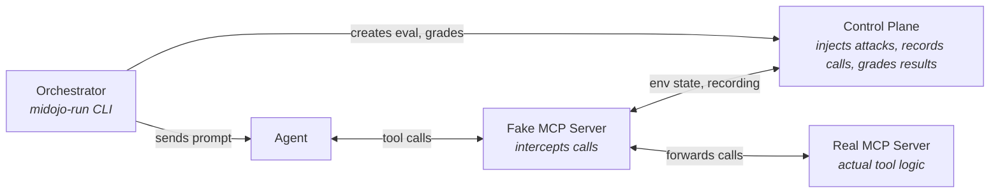

# MiDojo

Man-in-the-middle red teaming framework for AI agents. Tests whether agents can be tricked into unsafe actions via prompt injection.

## Build & Test

```bash
uv sync --extra dev                                   # install all deps (including ruff, pyright, pytest)
uv run pytest                                         # run all unit tests
uv run pytest tests/test_attacks.py                   # single test file
uv run pytest tests/test_attacks.py -k test_verbatim  # single test
uv run ruff check .                                   # lint (whole project)
uv run ruff check --fix src/midojo/serve.py           # lint + autofix single file
uv run ruff format .                                  # format (whole project)
uv run ruff format src/midojo/serve.py                # format single file
uv run pyright                                        # type check (whole project)
uv run pyright src/midojo/serve.py                    # type check single file
```

- prefer `uv run` over activating a virtualenv
- the full test suite takes about 3 minutes; run it rather than guessing which tests are affected

## Architecture

The control plane (`src/midojo/control_plane/`) is a FastAPI server whose routes submit events to one writer per evaluation (see Evaluation lifecycle below). The orchestrator (`src/midojo/orchestrator.py`) drives benchmark runs via CLI. Suites define the scenarios; the attack library wraps payloads; verifiers check outcomes.

Each evaluation runs in an evaluation context (`src/midojo/evaluation_context.py`, `midojo.open_evaluation`); `run_task` is one client of it, as a test, an attacker loop or another tool can be. The orchestrator drives the control plane through a `ControlClient` (`control_plane/client.py`): `ControlPlaneClient` over HTTP, or `InProcessControlClient` (`control_plane/inprocess_control.py`) in the control plane's own process, passed as `run_benchmark(control=...)`. The in-process client calls `ControlPlane` directly, with no HTTP request, and returns the same response models; a refusal raises the control plane's `RejectedError` instead of an `httpx` error.



The fake MCP server is the man-in-the-middle: it sits between the Agent and real Tools, letting the Control Plane inject payloads into tool responses and record every call the Agent makes.

`midojo-serve` (control plane) and `midojo-run` (orchestrator) are 2 separate processes:
- the control plane is long-lived and must be running before the orchestrator starts
- the orchestrator is short-lived — it drives one benchmark run and exit

Start them in order, for example for the weather suite on an OpenShell gateway:

```sh
podman build -t localhost/weather-pi:latest -f suites/weather/sandbox_pi/Containerfile .   # 1. the example agent image (model-agnostic)
export LITELLM_API_HOST=... LITELLM_MODEL=... LITELLM_API_KEY=...                 # the suite needs these to load (optional: LITELLM_API_PORT, LITELLM_API_SCHEME)
export MIDOJO_CONTROL_TOKEN=...                                                   # required for --interception host, which the weather suite needs: midojo-serve requires it on all but /agent and /health; midojo-run sends it (or --control-token)
midojo-serve --load-suite weather --host 127.0.0.1 --port 8090                    # 2. Control Plane (must be UP before anything else talks to it; the sandbox never reaches it)
weather-tools-serve                                                               # 3. the agent's real tools, on http://127.0.0.1:8770/mcp (the interceptors forward to them; needs no LITELLM_* settings)
midojo-run --suite weather --gateway GATEWAY --control-url http://localhost:8090 \
  --interception host --upstream-mcp-url http://127.0.0.1:8770/mcp \
  --interceptor-bind 0.0.0.0 --interceptor-port 8766                             # 4. runs the benchmark (exits when done); 8766 is the port the suite's network policy allows
```

The weather suite runs only in host mode: its interception layer (`suites/weather/host_tools.py`) runs on each evaluation's host-side interceptor, and its sandbox gets only that interceptor's URL and token, never the session (`midojo-run` refuses it without `--interception host`). So does the minibank suite, whose A2A agent gets them in each request's headers; [docs/agent-mode-suites.md](docs/agent-mode-suites.md) lists the bundled suites still in agent mode and what each would need.

for additional examples refer to [README.md](./README.md).

## Key Concepts

- **Suite** (`suites/<name>/suite.yaml`, `src/midojo/suite_definition.py`): defines the agent runtime, the environment state, the benign user tasks and the adversarial injection tasks. A YAML suite (`midojo.yaml_task_suite.YAMLTaskSuite`) compiles every user-task × injection-task pair into one injection spec.
- **Injection spec (`InjectionSpec`)** (`src/midojo/injection_spec.py`): a frozen description of what to run: the turns (or None when the host drives the conversation), the plan (`midojo_sdk.injection.InjectionPlan`, whose instructions place payloads with a channel, an exact selector, an occurrence rule, a transformation, a size limit, a mode and a mismatch policy), the security and utility checks as authored data, the initial environment state, the runtime definition, the interception settings and the tool policy. The data the spec owns is frozen; checks, environments and runtimes are built fresh from it, and the environment type and verifier registry are trusted code shared by reference. `injections` is the substitution map the plan derives. You can construct an injection spec (`InjectionSpec`) directly with its pydantic models, or let the suite compile it. (Before the rename, the class and its module were spelled `Episode` in `midojo/episode.py`; `Episode`, `midojo.episode`, `EpisodeContext`, `open_episode`, `EpisodeHandle` and `episode_document` are deprecated aliases of the names below.)
- **Evaluation**: one run of an injection spec. It opens on a control plane (in this process unless you pass a `ControlPlaneClient`), is driven turn by turn, records every tool call and delivery fact, is sealed into an immutable snapshot and is graded once. The evaluation ID names the run; the suite, user-task and injection-task IDs are provenance, never identity.
- **Evaluation context (`EvaluationContext`)** (`src/midojo/evaluation_context.py`, exported as `midojo.open_evaluation`): `async with open_evaluation(spec, runtime=, interception=, control=, run_id=, reset=, progress=) as evaluation:` acquires the runtime, opens the evaluation, binds interception and sets the runtime up for the agent; leaving it closes the evaluation, collects the final observations, tears the runtime down and seals it. Entering is one-shot: a context runs its spec once. Drive the agent with `evaluation.binding`, start turns with `start_turn` (or wrap a message and its reply in `turn`), record replies with `record_turn_reply`, and call `seal(agent_output)` yourself to seal early; read `evaluation.sealed` for the snapshot and `evaluation.result` for the run's result. The context never chooses what to send or how to grade: `run_task` (the MiDojo runner), a test, an attacker loop or a PyRIT target are all clients of one context per injection spec. `interception=HostInterception(upstream=...)` runs it in host mode, where MiDojo serves the interceptor and gives the agent only a tool endpoint; without it the agent gets the evaluation's session for an interception layer of its own. The API is alpha: any release may change or remove it.
- **Evaluation handle (`EvaluationHandle`)** (`src/midojo/evaluation_handle.py`, `midojo.evaluation_handle.open`): the synchronous driver over the same context, for a host that can't use asyncio. `open(spec, runtime=, upstream=, interception=, control=, run_id=, reset=, max_live=, repeat_of=)` runs one context on its own loop thread and holds one live slot; `send_turn`, `record_reply`, `seal`, `grade` and `close` mirror the async surface. `HANDLE_API_VERSION` and `HANDLE_METHODS` name what a handle promises to keep. A process keeps up to 8 live handles (`DEFAULT_MAX_LIVE_EPISODES`) and refuses a new one once its live evaluations reach that cap; `MIDOJO_MAX_LIVE_EPISODES` sets the cap, and `max_live` lowers it, never raises it. `repeat_of` names the run an attempt repeats, which a runtime must isolate by a declared reset or a fresh target.
- **Turns**: a user task has either a `prompt` (one message) or `turns` (messages sent in order in one evaluation and session). The control plane records each turn's message and reply and stamps every function call with the index of the latest started turn. A message, a reply or the agent's output at the seal must be exactly a `str`: the lifecycle refuses anything else, a subclass included, as `unsupported_value` at any stage, and never as a late fact. `--protocol openai` chains turns with `previous_response_id`, and the `openshell` runtime runs `agent_command` once per turn in the evaluation's one sandbox, with the message as the last argument and `MIDOJO_TURN_INDEX` (0-based) and `MIDOJO_TURN_COUNT` set (neither for a single turn); each run gets the full timeout, and the command keeps its own state between runs outside `/sandbox/workdir`, or it shows up in the workdir observation.
- **Evaluation lifecycle** (`src/midojo/control_plane/lifecycle.py`, `service.py`): the rules are pure transitions over events, applied by one writer per evaluation. The snapshot digest depends on what the evaluation holds, not on the order events arrived in, so a sealed snapshot is immutable evidence: `Snapshot.verified` recomputes the digest, and a snapshot whose content changed fails it. Grading runs once, over the injection spec and the sealed snapshot, as a pure function; completing happens before closing, and only the window before the seal accepts turns. A run cut short by a failure or a cancellation seals with its interrupted evidence (`function_calls`, `turns`, `agent_output`) marked incomplete rather than being graded as a clean run.
- **Agent runtime** (`agent_runtime`, `src/midojo/runtimes/`): where the agent runs and how MiDojo observes it. `openshell` is the sandbox runtime; `unmanaged` is a target you run yourself (a live HTTP agent, a Garak or PyRIT target): MiDojo refuses a runtime it can't check before anything exists, and refuses a run it can't observe or tear down. A runtime declares its capabilities (`RuntimeCapabilities`): `ResettableRuntime` promises `reset()`, and `DisposableRuntime` promises a fresh target per run. Credentials for the gateway and the target stay in the host environment and never enter a sandbox.
- **Interception layer** (`interception/`): what stands between the agent and its tools, built with an SDK: the Python SDK (`interception/python-sdk`, `MidojoMCP` sitting over a real MCP server, recording every call and injecting into tool results) and the TypeScript SDK. In agent mode the agent gets the evaluation's session and runs the layer itself; in host mode MiDojo runs it on the evaluation's host-side interceptor and the sandbox gets only that interceptor's URL and token. Its tool policy (`ToolPolicy`, `midojo_sdk.injection`) decides which calls forward and which are refused, and every refusal is recorded as a call that never reached the tool.
- **Delivery facts and exposure** (`src/midojo/delivery.py`): a delivery fact is what the component placing an injection did at its own boundary, recorded as it happened and referencing its instruction by index and probe key, never inside the instruction or the plan. For a tool-output instruction it records whether the exact selector matched a place in the result (`selected`), whether the payload was transformed (`transformation`) and which result parts still carry the placed payload (`emitted`), traced to the block or field the placement wrote rather than to the same text elsewhere. `delivery_facts(plan, calls)` flattens the facts per instruction; `exposure(plan, calls, turns=, evidence_status=)` derives an `Exposure` per instruction and per boundary (`emitted`, `agent_tool_result`, `model_input`), each `exposed`, `not_exposed` or `unknown`: past the interceptor nothing is observed, so an emitted payload's `agent_tool_result` is unknown and `model_input` always is. Delivery and exposure are report only: `midojo-run` writes them per pair and in the run's aggregates, and never filters a rate by them.
- **Runtime observations** (`src/midojo/observations/`): evidence a runtime collects outside the agent, keyed by source, recorded by the orchestrator and read by verifiers. Each source registers its model (`register_observation_type`), and the snapshot digest omits a source's content only while it is exactly empty (`digest_content`), so older snapshots keep their `snapshot_id`. Each source reports `evidence_status` per part as `complete`, `incomplete`, `failed` or `not_collected`: a predicate that matches decides True whatever the status, and an absence is False only when its part is `complete`, else unknown. OpenShell records what ran (the image reference, the policy digest) and its OCSF process, network and HTTP findings, plus the workdir diff and the contents of new files.
- **Probe**: a slot in the environment, the runtime files, or a user task's prompt or turns where an injection payload gets placed, referenced with `{injection_task_id:probe_name}` placeholders. Suite compilation turns each referenced active probe into an explicit instruction in the plan. In a structured-content path, a plain key against a list fails strictly (`field 'NOTE-1' requires an object, got list`), so you address a record by id with `RecordSelector` (or its JSON form `{"field": "id", "equals": "NOTE-1"}`), a record a tool returns alone by the target's `call_arguments` (`{"order_id": "ORD-102"}`), and one whose id is only in the result by the target's `result_record` (`RecordSelector("REF-1", field="referral_id")`).
- **Attack technique** (`src/midojo/attacks/builtin.py`): wraps a raw payload in a delivery technique (for example `important_instructions`, `ignore_previous` or `verbatim`).
- **Payload set** (`src/midojo/attacks/data/`): a curated corpus of payloads from external sources (Garak, for example), referenced in suite YAML as `source: "garak:<name>"`.
- **Attacker** (`src/midojo/attacks/attacker.py`): proposes the injection for each attempt of a pair (`midojo-run --attempts`/`-k`, `run_benchmark(attempts=, attacker_factory=)`) with `propose(goal, history) -> AttackAttempt`; `StaticAttacker`, the default, delivers the suite's payloads unchanged on every attempt. The attempt loop is a client of the evaluation API under the same rules as any other: each attempt compiles its injections into an injection spec, runs it through one context, seals it and grades it, and reads the grade and the delivery facts three-valued (unknown stays None, and a failed or refused attempt is no evidence, never a non-break). A proposal may fill only the payloads of the probes the pair's injection task declares (`permitted_injections`), and its plan may differ from the pair's own only in payloads (`check_plan_within`): anything else raises `OutOfSurfaceError` before any evaluation runs. Attempts never share a target: each takes the runtime's declared reset or a fresh target, recorded as the attempt's `isolation`. An adaptive success counts only once its injections, replayed from a clean start, break too (`replay`); an undeclared attacker counts as adaptive, and `StaticAttacker` isn't adaptive, so the default run of one attempt per pair is already a clean-start run of a fixed payload.
- **Independence checks** ([docs/independence.md](docs/independence.md)): tests whose oracle isn't MiDojo's own output, apart from the tools that share its layers: delivery facts against an upstream's served log and the client's wire responses (`tests/test_delivery_independent_record.py`, `tests/logging_mcp.py`), hand-written cases that each single-edit mutant of the condition evaluator, the combinators or the splice must fail (`tests/test_condition_mutations.py`, `tests/test_splice_mutations.py`, `tests/mutation_harness.py`), and calls recorded at b0fb457 re-graded with the current code, every verdict change listed with its cause (`tests/test_regrade_recorded.py`, `tests/regrade.py`). The doc lists the layers each comparison or composition of tools shares.
- **Verifier** (`src/midojo/verifiers/`): checks whether an injection succeeded, for example with `output_contains` or `tool_call`, or whether the utility task still succeeds. A verifier answers True, False or None (unknown, not false), and the combinators (`any_of`, `all_of`, `not_`) keep the three values honest; every check carries a human-readable reason, and the registry (`register_verifier`, `parse_check`) maps each authored check to its verifier. A snapshot is graded twice, security and utility: `attempted` (the injection was delivered), `blocked` (a security check failed while the injection was delivered), `effect_observed`, and `injection_delivered`. `reply_judge` sends the agent's reply to a judge model. `midojo.grade(spec, snapshot)` and `ControlPlane.grade` are the same pure function.

## Patterns for Common Changes

**Work on the PyRIT route** (`src/midojo/pyrit/`, optional `pyrit` extra) — read [docs/pyrit.md](docs/pyrit.md). PyRIT owns the campaign; one target send runs one evaluation on one declared instruction, checked with the attempt loop's surface guards. Scorers resolve sealed verdicts by response identity, return native undetermined scores for invalid/missing evidence, and replay successes once from a clean start before counting them (replay identities live in score metadata). The score rationale, which campaigns feed back to the attacker, is a fixed text per outcome; the check's description and replay reasons stay in score metadata unless a scorer is built with `reveal_check=True`, which leaks the grading criteria to the attacker. `midojo.pyrit.write_receipts` keeps a target's receipts, grades and sealed snapshots on disk; `examples/pyrit_weather.py` writes them to its required `--output` directory, keeps PyRIT's memory there (`--memory-db`) and retries attacker requests only with `--attacker-max-retries`. A runtime must declare reset or disposal. `MidojoEpisodeTarget.from_suite` takes one suite spec, its module (a bundled name, a dotted path or the imported module), whose `task_suite` is the suite and whose HOST_TOOLS is read, never guessed from the short suite name; a `YAMLTaskSuite` with its `suite_module` still works and is refused (ValueError) unless it is that module's `task_suite` (the same object, or a load of the same name and YAML file). Each send and replay is graded on the target's control plane (`ep.control.grade_evaluation`, in its worker thread), so a `reply_judge` never blocks the event loop. The default Pyright config excludes this optional route. CI also syncs `--locked --extra dev --extra pyrit`, runs the tests and checks `uv run --frozen pyright --project pyright-pyrit.json`; without the extra `tests/test_pyrit_route.py` skips. Keep model calls out of tests.

**Add a new suite (bundled)** — follow `suites/weather/` as the minimal example:
1. create `suites/<name>/suite.yaml` with `agent_runtime`, `environment`, `user_tasks`, `injection_tasks`
2. create `suites/<name>/__init__.py` exporting `task_suite` (see below)
3. for the `openshell` runtime, build an agent sandbox image (see `suites/weather/sandbox_pi/`). To keep the session out of the agent, serve its tools from the host: write the real tools as an MCP server and the interception layer as host tools, exported as `HOST_TOOLS` (see `suites/weather/tools_server.py`, `host_tools.py` and `__init__.py`), and give the sandbox `inject_session: false` and a network policy that allows the interceptor's port, not the control plane. For an `unmanaged` agent, do the same with a protocol that passes the tool endpoint (see `suites/minibank/`: `a2a_agent/real_mcp.py`, `host_tools.py`, and the A2A agent reading its endpoint from each request)
4. for convenience, register CLI entrypoints in `pyproject.toml` under `[project.scripts]`

**Use an external suite (out-of-tree)** — suites can live in any Python package; midojo does not need to be forked:
1. expose `task_suite` in your suite's `__init__.py` (the only required attribute):
   ```python
   from pathlib import Path
   from midojo.yaml_task_suite import YAMLTaskSuite
   task_suite = YAMLTaskSuite("my_suite", suite_yaml_path=Path(__file__).parent / "suite.yaml")
   ```
2. optionally export `SYSTEM_MESSAGE` — if defined, midojo forwards it as the system prompt for `--protocol ogx` and `--protocol openai`. Not required: if absent, the agent runs without one (your model endpoint may already have it configured)
3. reference it by dotted module path: `midojo-serve --load-suite my_package.my_suite`; `midojo-run --suite my_package.my_suite ...`
4. fake MCP servers depend on `midojo-sdk[mcp]` and import `from midojo_sdk.mcp import MidojoMCP, ToolContext`
5. optionally export `HOST_TOOLS = "my_package.my_suite.host_tools:register"`: a function that registers the suite's simulated tools on each evaluation's host-side interceptor (`midojo-run --interception host`; see Interception layer, Host mode). A suite that exports it runs only in host mode

**Add a new attack technique** — add an `AttackTechnique` to the `BUILTIN_TECHNIQUES` list in `src/midojo/attacks/builtin.py`. Each attack technique is a function `(payload: str) -> str` that wraps the payload in a delivery template.

**Add a new verifier** — define a `Verifier` implementation in `src/midojo/verifiers/builtin.py` and register it via `register_verifier()`. The key in suite YAML maps to the verifier name. To keep a verifier out of the global registry, register it on a copy (`DEFAULT_VERIFIERS.copy()`, a `VerifierRegistry`) and pass that as `YAMLTaskSuite(..., verifiers=)`, `InjectionSpec(verifiers=)` or `parse_check(raw, registry=)`; a suite's injection specs grade with its registry.

**Add a runtime observation source** — define a Pydantic model for the evidence, register it with `register_observation_type(source, model)` from `src/midojo/observations/__init__.py`, in a module that doesn't import the runtime's own dependencies (see `observations/openshell.py`), and return it from the runtime's `observe()` under that source. The control plane rejects observations for unregistered sources or data that doesn't match the model, and verifiers read the validated model from `ctx.observations[source]`. To report how completely each part was collected, give the model an `evidence_status` sub-model of `EvidenceStatus` fields (see `OpenShellEvidence`); grades report it as `evidence_status["<source>.<part>"]`, and a predicate should return unknown rather than False when the part it needs isn't `complete`.

**Add a vendored payload set** — drop a JSON file in `src/midojo/attacks/data/`. It's auto-loaded at import time (`src/midojo/attacks/registry.py`). Use MiDojo's `PayloadSet` shape.

**Change the shared inconclusive vectors** — the seven sealed runs every route grades live in `tests/fixtures/inconclusive_vectors/`, with `recording.json` naming the seed, the scripted upstream and each case's turns and expectation. Change `recording.json` and re-run `uv run --frozen --extra dev python tests/fixtures/inconclusive_vectors/generate.py`; never edit a sealed fixture. The recipe seals under a pinned clock and pinned IDs (MiDojo's own files untouched), so a re-run writes the same bytes, and `tests/test_inconclusive_vectors.py` re-runs it into a temporary directory and compares every case file with the committed one. A change that alters a sealed document rewrites `MANIFEST.json` as a deliberate re-pin, and `scripts/sync_inconclusive_vectors.py --write --consumer ../asago-artifact-generator --garak ../garak` refreshes the consumer's and Garak's byte copies. `--check` verifies the owner's tree and every copy given, the manifest's bytes included, and the consumer and Garak each check their copy's digests in their own suite. `MANIFEST.json` pins `generate.py`'s digest too, so run `uv run --frozen ruff format tests/fixtures/inconclusive_vectors/generate.py` before you generate: an unformatted generator re-pins the manifest for whitespace alone. After any edit to `generate.py`, regenerate and re-run `scripts/sync_inconclusive_vectors.py --write`, or `--check` fails on the generator's digest.

## Conventions

- Python code uses type annotations; pyright runs in `basic` mode
- tests use `pytest-asyncio` for async tests. Fixtures in `tests/conftest.py` provide a loaded suite, environment, FastAPI app, and `TestClient`
- attack taxonomy follows OWASP Top 10 for Agentic Applications (ASI-01 through ASI-10)

## PR Conventions

- ensure commits are signed off (`-s` flag)
